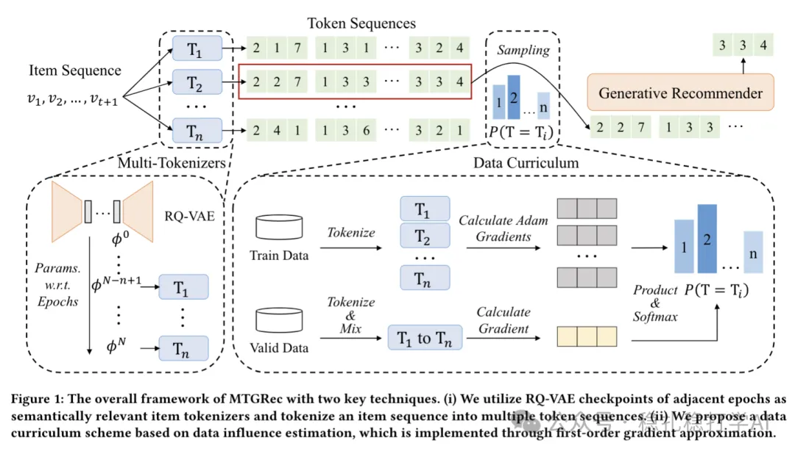

# Recommendation papers (2025.4.13): Huawei MTGRec, generating multiple token sets per item from several RQ-VAE checkpoints
> [中文版](2025-04-13-huawei-mtgrec-multi-identifier.md)

> Source: WeChat post https://mp.weixin.qq.com/s?__biz=MzkzNDYyNjM1NA==&mid=2247484463&idx=1&sn=90353108084037be368a109f3df35b2d&scene=21#wechat_redirect, published 2025-04-13.
> Split from the roundup "Recommendation papers (2025.4.13): RQ-VAE is like the Transformer, reshaping recommendation"; same issue: [Meituan RQ-VAE in industrial practice](../sid/2025-04-13-meituan-rq-vae.full.en.md), [Alibaba IRM multi-interest extraction](../behavior-sequence-modeling/2025-04-13-ali-irm-multi-interest.full.en.md), [Huawei MTGRec multi-identifier item tokenization](../sid/2025-04-13-huawei-mtgrec-multi-identifier.full.en.md).

Pre-training Generative Recommender with Multi-Identifier Item Tokenization

Link: https://arxiv.org/pdf/2504.04400

Company: Huawei

Area: LLM recommendation + generative + long tail

Overview:

The paper proposes a way to generate multiple tokens for each item before LLM-based generative recommendation.

Specifically:

(1) How the multiple tokens are generated

The checkpoints of the same RQ-VAE model from the last N epochs are used to generate N tokens for each item at the current epoch.

(2) Multiple sequences and targets are generated for the sequence and for the next item respectively, but for efficiency, one sequence is sampled from them and fed to the LLM recommender for training.

Motivation: data augmentation.

LLM recommendation is sequence-to-sequence recommendation: before feeding the generative model, each item has to be turned into tokens by RQ-VAE. The innovation of this paper is that, to take care of long-tail items, each item gets multiple tokens. The authors argue that generating a single token is bad for long-tail items, which end up under-learned.

The tokens generated for an item by historical versions of RQ-VAE work because the cluster an item lands in under RQ-VAE fluctuates, i.e. noise is added, so this can be seen as a form of data augmentation.

Takeaways: using only the final RQ-VAE to generate token sequences would look short on novelty; adding the data augmentation makes it better, and the method is fairly novel.

Credibility: offline

Recommendation: read if you have time

Figure 1: The overall framework of MTGRec with two key techniques. (i) We utilize RQ-VAE checkpoints of adjacent epochs as semantically relevant item tokenizers and tokenize an item sequence into multiple token sequences. (ii) We propose a data curriculum strategy…
