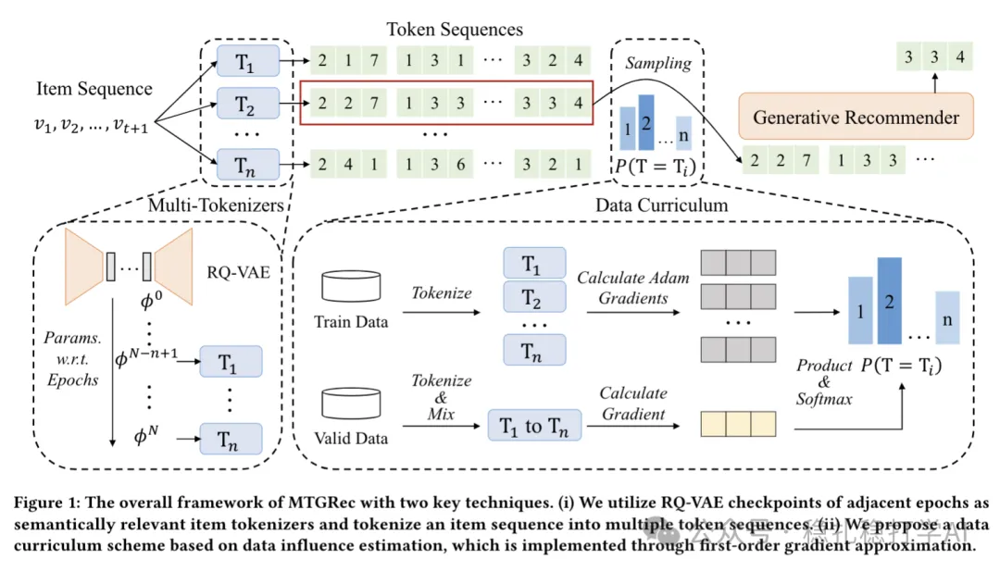

# 推荐算法(2025.4.13)：华为MTGRec，用RQ-VAE多个checkpoint为item生成多套token

> 原文：https://mp.weixin.qq.com/s?__biz=MzkzNDYyNjM1NA==&mid=2247484463&idx=1&sn=90353108084037be368a109f3df35b2d&scene=21#wechat_redirect
> 作者：算法工程师刘明星（稳扎稳打学AI）| 发表于 2025-04-13
> 本文拆自《推荐算法(2025.4.13)：RQ-VAE犹如Transformer，重塑推荐》，同期 3 篇：[美团 RQ-VAE 工业实践](../sid/2025-04-13-meituan-rq-vae.md)、[阿里 IRM 多兴趣提取](../behavior-sequence-modeling/2025-04-13-ali-irm-multi-interest.md)、[华为 MTGRec 多标识 item tokenization](../sid/2025-04-13-huawei-mtgrec-multi-identifier.md)。

关注我，每天为你精挑细选最优质、最新鲜的推荐算法paper，陪你一起保持进步、不断精进！

> [English version](2025-04-13-huawei-mtgrec-multi-identifier.full.en.md)

Pre-training Generative Recommender with Multi-Identifier Item Tokenization

网址：https://arxiv.org/pdf/2504.04400

公司：华为

方向：LLM推荐+生成式+长尾

解读：

本文提出了一种在LLM生成式推荐前为item生成多个token的方法。

具体的，

（1）生成多个token的方法

就是同一个RQ-VAE的模型的最近N个epoch里的checkpoint，为当前epoch的每个item生成N个token。

（2）序列和next-item分别生成多个序列和目标，但是为了效率，从中sampling一个序列进入LLM推荐器做训练。

动机：数据增强。

LLM推荐是序列到序列的推荐，在输入到生成式模型前，需要为每个item通过RQ-VAE转成token，这本的创新为为照顾长尾物料，每个item要生成多个token。作者觉得生成单个token，对长尾物料不利，学习不充分。

用RQ-VAE历史版本为item生成的token，因为item找到在RQ-VAE找到的cluster是有波动的，是加入了噪音的，可以看作是数据增强的一种做法。

心得：如果只用正式的RQ-VAE生成token序列，显得创新不足，加上数据增强的方法就要好一些，这种方法还算是挺新奇的。

可信度：离线

推荐等级：有时间看看

Figure 1: The overall framework of MTGRec with two key techniques. (i) We utilize RQ-VAE checkpoints of adjacent epochs as semantically relevant item tokenizers and tokenize an item sequence into multiple token sequences. (ii) We propose a data curriculum strategy…
