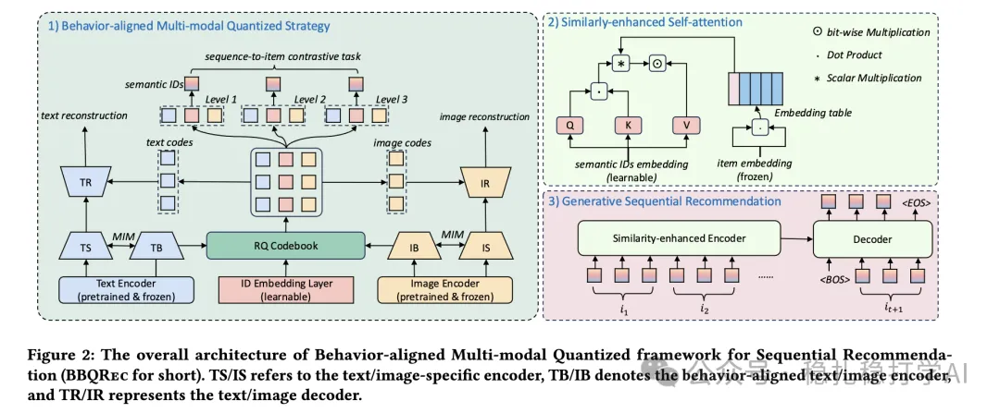

# Recommendation papers (2025.4.13): Meituan RQ-VAE, industrial practice from quantization to recommendation
> [中文版](2025-04-13-meituan-rq-vae.md)

> Source: WeChat post https://mp.weixin.qq.com/s?__biz=MzkzNDYyNjM1NA==&mid=2247484463&idx=1&sn=90353108084037be368a109f3df35b2d&scene=21#wechat_redirect, published 2025-04-13.
> Split from the roundup "Recommendation papers (2025.4.13): RQ-VAE is like the Transformer, reshaping recommendation"; same issue: [Meituan RQ-VAE in industrial practice](../sid/2025-04-13-meituan-rq-vae.full.en.md), [Alibaba IRM multi-interest extraction](../behavior-sequence-modeling/2025-04-13-ali-irm-multi-interest.full.en.md), [Huawei MTGRec multi-identifier item tokenization](../sid/2025-04-13-huawei-mtgrec-multi-identifier.full.en.md).

RQ-VAE: from quantization to recommendation, the go-to choice in industrial practice

Link: https://arxiv.org/pdf/2504.05507

Company: Meituan

Area: RQ-VAE

Overview:

(1) RQ-VAE structure: the encoder quantizes the input item embedding level by level to get the item's semantic ID sequence; each level of residual quantization further refines the representation.

(2) Hierarchical decoder: the decoder generates the user's personalized behavior sequence from the semantic IDs, improving recommendation quality.

(3) Industrial deployment: Meituan's experiments show RQ-VAE performs well at improving recall and ranking, and it can be widely applied to scenarios such as ads and video feeds.

Takeaways: RQ-VAE is very widely used in industry and integrates multimodal data effectively. In particular, it uses many generative recommendation techniques, such as turning the sequence problem of user behavior sequences into a generative recommendation problem.

Credibility: offline

Recommendation: worth reading

