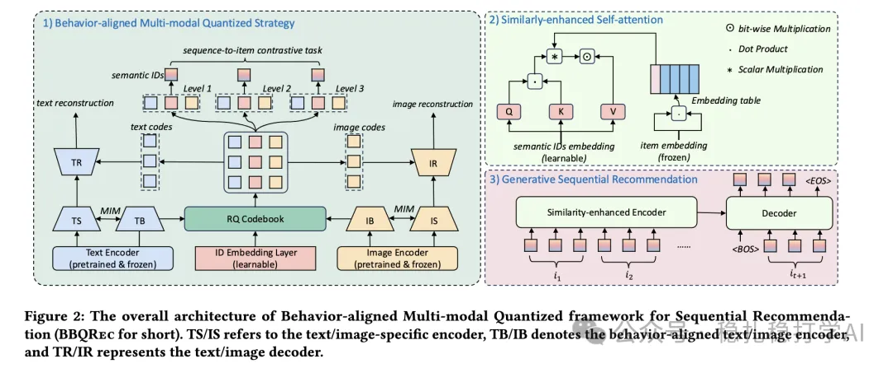

# 推荐算法(2025.4.13)：美团RQ-VAE，从量化到推荐的工业实践

> 原文：https://mp.weixin.qq.com/s?__biz=MzkzNDYyNjM1NA==&mid=2247484463&idx=1&sn=90353108084037be368a109f3df35b2d&scene=21#wechat_redirect
> 作者：算法工程师刘明星（稳扎稳打学AI）| 发表于 2025-04-13
> 本文拆自《推荐算法(2025.4.13)：RQ-VAE犹如Transformer，重塑推荐》，同期 3 篇：[美团 RQ-VAE 工业实践](../sid/2025-04-13-meituan-rq-vae.md)、[阿里 IRM 多兴趣提取](../behavior-sequence-modeling/2025-04-13-ali-irm-multi-interest.md)、[华为 MTGRec 多标识 item tokenization](../sid/2025-04-13-huawei-mtgrec-multi-identifier.md)。

关注我，每天为你精挑细选最优质、最新鲜的推荐算法paper，陪你一起保持进步、不断精进！

> [English version](2025-04-13-meituan-rq-vae.full.en.md)

RQ-VAE：从量化到推荐，工业实践的首选方案

网址：https://arxiv.org/pdf/2504.05507

公司：美团

方向：RQ-VAE

解读：

（1）RQ-VAE结构：其编码器将输入的item embedding逐层量化，得到item的semantic ID序列，每层残差量化进一步细化表示。

（2）分层解码器：解码器根据semantic ID生成用户的个性化行为序列，优化推荐效果。

（3）工业化部署：美团的实验证明，RQ-VAE在提升召回率和排序效果上表现突出，可广泛应用于广告、视频流等场景。

心得：RQ-VAE在工业界应用非常广泛，有效整合多模态数据。特别是它用到了很多生成式推荐的技术，比如把用户行为序列的序列问题转化为生成式推荐问题。

可信度：离线

推荐等级：推荐看看

