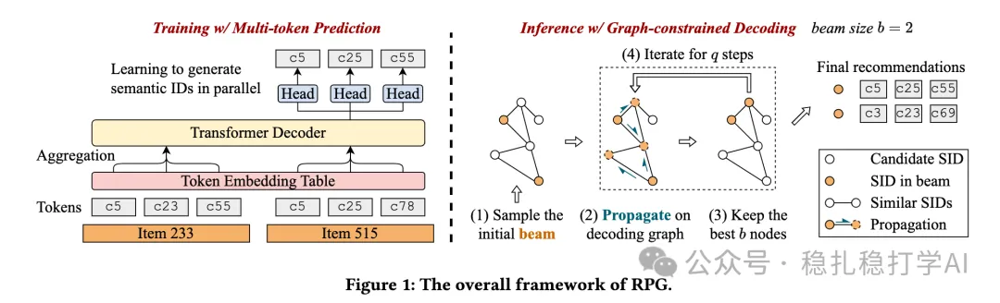

# Recommendation Papers (2025.6.12): Meta's generative recommendation method

> [中文版](2025-06-12-meta-parallel-long-sid.md)

1 Generating Long Semantic IDs in Parallel for Recommendation

Link: https://arxiv.org/pdf/2506.05781

Company: Meta

Area: generative recommendation

Overview:

(1) Background: autoregressive generative recommendation in industrial recommender systems requires pretraining on a large corpus, which is very challenging given the huge numbers of users and items in industrial settings. Also, how to combine the parameters of a generative recommendation model with an industrial recommendation model is another challenge.

(2) Method: the paper proposes a new parallel generative recommendation method. By using multiple parallel long semantic IDs, it can make effective use of user behavior history and item features during sequence generation. Specifically:

Long semantic ID construction: Optimized Product Quantization (OPQ) encodes item features (text, images, etc.) into long semantic IDs (up to 64 tokens). Each token comes from a different codebook and encodes a semantic sub-vector of the item. Compared with residual quantization (RQ), OPQ has no ordering dependency between tokens, which suits parallel generation, and spreads information more evenly.

Parallel generation: a Transformer-decoder-based model predicts all tokens in parallel, escaping the token-by-token limitation and error accumulation of autoregressive generation, and also greatly improving generation efficiency.

Graph-constrained decoding: 1) Graph construction: the embeddings of the 64 tokens of each semantic ID are aggregated (e.g. mean or max pooling) into one semantic embedding. These embeddings are stored with the FAISS library, and for each semantic ID the top-k most similar semantic IDs (by embedding similarity) are searched. These similar IDs become the graph's edges, forming a sparsified decoding graph. 2) Decoding: initialize a set of candidate semantic IDs (the beam); at each step, following the graph structure, keep the semantic IDs in the beam that are most relevant to the current candidates, while adding randomness to encourage exploration.

Takeaways: a way for large models to assist recommendation models.

Credibility: production

Recommendation: recommended

