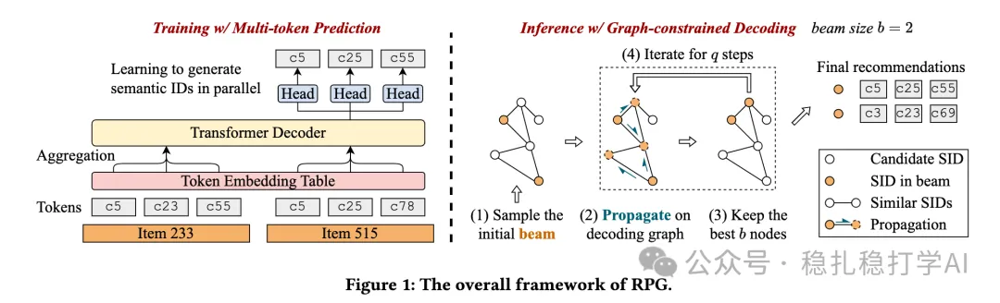

# 推荐算法(2025.6.12)：Meta的生成式推荐方法

> 原文：https://mp.weixin.qq.com/s?__biz=MzkzNDYyNjM1NA==&mid=2247484793&idx=1&sn=68ca1d3f310adf309060ac20f949daa4&scene=21#wechat_redirect
> 作者：算法工程师刘明星（稳扎稳打学AI）| 发表于 2025-06-12

嘿，记得给“稳扎稳打学AI”添加星标

关注我，每天为你精挑细选最优质、最新鲜的推荐算法paper，陪你一起保持进步、不断精进！

👆 [本公众号paper推荐原则](https://mp.weixin.qq.com/s?__biz=MzkzNDYyNjM1NA==&mid=2247484097&idx=1&sn=18322c279290b555eb030e12953b7c7f&scene=21#wechat_redirect)

1 Generating Long Semantic IDs in Parallel for Recommendation

网址：https://arxiv.org/pdf/2506.05781

公司：Meta

方向：生成式推荐

解读：

（1）背景 — 工业推荐系统中的自回归生成式推荐，需要在大规模语料上预训练，这对工业场景的大量用户、item，挑战很大。此外，如何将生成式推荐的模型参数和工业推荐模型结合也是一个挑战。

（2）方法 — 本文提出了一种新颖的并行生成式推荐方法，通过使用多个并行长语义ID（parallel long semantic IDs），在序列生成时可以有效地利用用户历史行为和物品特征。具体来说：

长语义ID构造：使用优化产品量化（OPQ）将物品特征（文本、图像等）编码为长语义ID（最多64个token），每个token来自不同codebook，编码物品语义子向量。相较于残差量化（RQ），OPQ无token间顺序依赖，适合并行生成，且信息分布更均衡。

并行生成：采用基于Transformer解码器的模型并行预测所有token，摆脱自回归生成逐token预测的限制和误差积累，同时显著提升生成效率。

图约束解码：1）图构建：将每个语义ID的64个token的embedding聚合（例如均值或最大池化）成一个语义embedding。使用FAISS库存储这些embedding，并为每个语义ID搜索top-k个最相似的语义ID（基于embedding相似性）。这些相似ID作为图的边，构建稀疏化的解码图。2）解码：初始化一组候选语义ID（beam），每一步根据图结构，在beam中保留与当前候选最相关的语义ID，同时引入随机性以促进探索。

心得：大模型辅助推荐模型的一个方法。

可信度：生产

推荐等级：推荐看看

请帮忙点赞、转发，谢谢。您认为哪篇论文最有潜力应用到实际业务中？

## 欢迎干货投稿 \ 论文宣传 \ 合作交流

推荐您继续阅读：

■ [推荐算法(2025.6.11)：Google的意外推荐](https://mp.weixin.qq.com/s?__biz=MzkzNDYyNjM1NA==&mid=2247484786&idx=1&sn=1170e694c1f7a2c6759cebf02e0f4945&scene=21#wechat_redirect)

■ [推荐算法(2025.6.10)：Meta的离线召回新方法](https://mp.weixin.qq.com/s?__biz=MzkzNDYyNjM1NA==&mid=2247484780&idx=1&sn=04d946019642bef0239567c2a1af97e1&scene=21#wechat_redirect)

■ [推荐算法(2025.6.9)：Meta的基于多模态知识蒸馏的I2I方法](https://mp.weixin.qq.com/s?__biz=MzkzNDYyNjM1NA==&mid=2247484773&idx=1&sn=db2b0b912f649427e1e076a8293e301a&scene=21#wechat_redirect)

历史文章索引：https://docs.qq.com/sheet/DYXZTZ0tseHRyZGtt?tab=BB08J2

由于公众号试行乱序推送，您可能不再准时收到稳扎稳打学AI的推送。为了第一时间收到本号的干货内容， 请将本号设为星标，以及常点文末右下角的“在看”。

喜欢的话点个在看吧👇

个人观点，仅供参考
