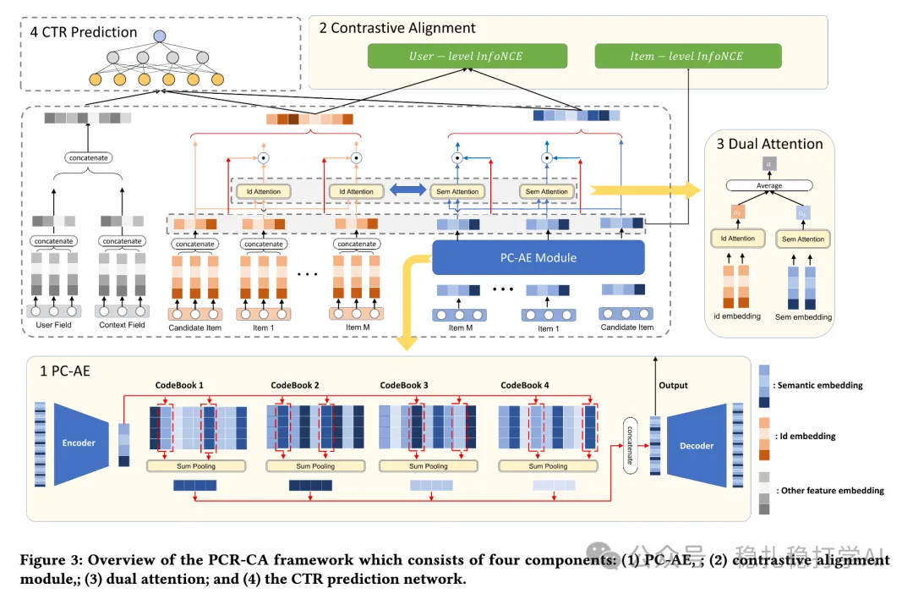

# Recommendation Papers (2025.8.30): Microsoft's semantic embedding alignment, simple and effective

> [中文版](2025-08-29-microsoft-semantic-embed.md)

1 PCR-CA: Parallel Codebook Representations with Contrastive Alignment for Multiple-Category App Recommendation

Link: https://arxiv.org/pdf/2508.18166

Company: Microsoft

Area: multimodal (fed into the main model via a codebook) + behavior sequences

Overview:

Brings multimodal embeddings into behavior sequence modeling.

That is, the multimodal embedding goes through a parallel codebook to get its semantic embedding, and contrastive alignment then bridges the semantic signal and the collaborative signal. The behavior sequence of semantic embeddings is also sequence-modeled. Specifically:

(1) Parallel Codebook AutoEncoder (PC-AE):

Uses N parallel codebooks (not residual). Each codebook picks the top-K (K=2) nearest code vectors to form the semantic embedding (stored as indices, which is efficient).

(2) Contrastive alignment module:

1) Item-level alignment: an item's semantic embedding and ID embedding form a positive pair (including recently co-installed items). Uses InfoNCE loss, with unrelated in-batch items as negatives. The numerator is a set.

2) User-level alignment: the user's ID representation is the average of historical ID embeddings; the content representation is the average of historical semantic embeddings; the two form a positive pair. Uses InfoNCE loss.

A/B: on the Microsoft Store homepage module "Games/Apps we think you Love", a 2-week test (50% of traffic). CTR +10.52%, CVR +16.30%, HER (high engagement rate) +1.97%. HER is defined as active users / total users.

Takeaways:

(1) The key idea of this paper is that the semantic embedding obtained from the codebook needs to be aligned with the collaborative signal. Previously, most work just plugged the semantic embedding into the main network and called it done. Also, adding an auxiliary loss to the main task is a fairly simple operation.

(2) It modifies the numerator of the InfoNCE loss. Losses, like networks, can be modified flexibly.

(3) The author is in China and was influenced by the RQ-VAE trend. (4) The main idea is parallel codebooks. Apps are multi-category: WeChat, for example, is a messaging app, a short-video app and an e-commerce app at once. An ordinary codebook can't capture this kind of parallel category relationship; RQ-VAE can be understood as multi-level categories, so parallel codebooks are needed.

Credibility: production

Recommendation: practically useful, worth a look

