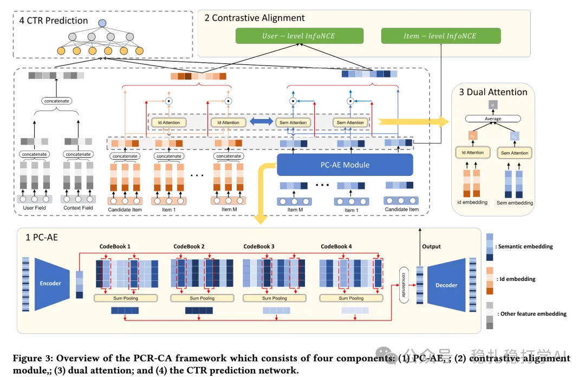

# 推荐算法(2025.8.30)：微软的语义embed对齐，简单有效

> 原文：https://mp.weixin.qq.com/s/aFfTgavsGzsvU9j5XYianw
> 作者：算法工程师刘明星（稳扎稳打学AI）| 发表于 2025-08-29（修改于2025年8月29日）

嘿，记得给“稳扎稳打学AI”添加星标

关注我，每天为你精挑细选最优质、最新鲜的推荐算法paper，陪你一起保持进步、不断精进！

👆 [本公众号paper推荐原则](https://mp.weixin.qq.com/s/BhVGu0qH5kTz9N5zpsD3KA)

1 PCR-CA: Parallel Codebook Representations with Contrastive Alignment for Multiple-Category App Recommendation

网址：https://arxiv.org/pdf/2508.18166

公司：微软

方向：多模态（通过codebook接入主模型）+行为序列

解读：

将多模态embed接入到行为序列建模过程中。

即多模态embed通过一个并行的codebook获得其语义embed，再通过对比对齐桥接语义信号和协作信号。语义embed行为序列也做序列建模。具体的，

（1）并行码本自编码器（PC-AE）：

使用N个并行码本（非残差），每个码本选Top-K（K=2）最近码向量，形成语义嵌入（通过索引存储，高效）。

（2）对比对齐模块：

1）项目级对齐：将项目语义嵌入和ID嵌入作为正对（包括最近共安装的项目）。使用InfoNCE损失，负样本为批次内无关项目。分子是一个集合。

2）用户级对齐：用户ID表示是历史ID嵌入平均；内容表示是历史语义嵌入平均，它们两个作为正对。使用InfoNCE损失。

AB：在Microsoft Store首页“Games/Apps we think you Love”模块，2周测试（50%流量）。CTR↑10.52%、CVR↑16.30%、HER（高参与率）↑1.97%。HER定义为活跃用户/总用户。

心得：

（1）本文的重要idea是认为codebook获得的语义embed要跟协同信号做对齐处理。之前，大多是直接将语义embed接入主网络万事了。而且，在主任任务，加辅助Loss是比较简单的操作。

（2）修改InfoNCE损失的分子。loss跟网络一样，可以灵活修改的。

（3）作者在中国，收到了RQ-VAE风潮的影响（4）主要idea是平行码本，app都是多类目，比如微信即是通信软件也是短视频还是电商，一般的码本抓不到这种平行的类目关系，rq-vae可以理解为多级类目，所以需要平行的码本

可信度：生产

推荐等级：有实践看看

请帮忙点赞、转发，谢谢。您认为哪篇论文最有潜力应用到实际业务中？

## 欢迎干货投稿 \ 论文宣传 \ 合作交流

推荐您继续阅读：

■ [推荐算法(2025.8.29)：Pinterest的Embed增强2.0，简单有效](https://mp.weixin.qq.com/s/u2VPDCyET_1Fj6SnFRwy6w)

■ [推荐算法(2025.8.28)：Meta的序列推荐系统，简单有效](https://mp.weixin.qq.com/s?__biz=Mzk0MTk1NjUxNQ==&mid=2247484743&idx=1&sn=0aa3d3a8ab8d4b7c33acfb4a2d1b5de0d8c&chksm=c2e2d3a2f59558d1ff1a4b3e3a0e0a1a0b1b0c1d1e1f1a1b&scene=21#wechat_redirect)

历史文章索引：https://docs.qq.com/sheet/DYXZTZ0tseHRyZGtt?tab=BB08J2

请入微信群，群内我会给出更深入的解读，还可以共同讨论技术方案、发招聘广告、内推和交友等。

• 铁粉标准：关注一个月以上，且累计10次互动（评论、爱心、转发）、或投稿1次。

• 入群方法：请您加个人微信lmxhappy，我拉您入群，请备注（只我个人看，不公开）。

喜欢的话点个在看吧👇

个人观点，仅供参考

修改于2025年8月29日
