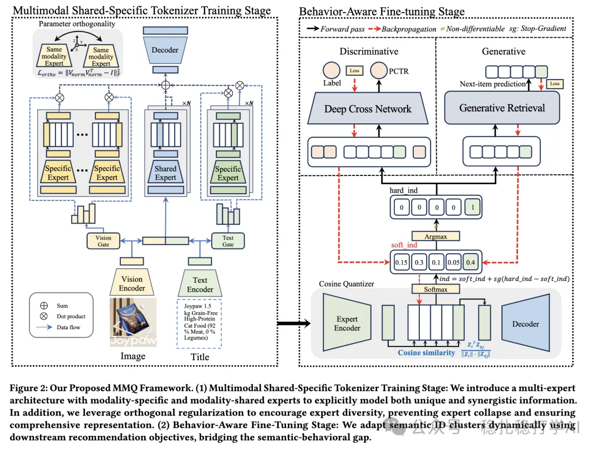

# Recommendation Papers (2025.9.15): Alibaba's multimodal, MMoE-style RQ-VAE

> [中文版](2025-09-15-ali-mmq-multimodal-rqvae.md)

1 MMQ: Multimodal Mixture-of-Quantization Tokenization for Semantic ID Generation and User Behavioral Adaptation

Link: https://arxiv.org/pdf/2508.15281

Company: Alibaba

Area: multimodal

Overview:

In short, it uses different experts to build separate codebooks that express different information from the modalities. Shared experts and modality-specific experts first extract representations separately, they are then trained with contrastive learning and reconstruction tasks, and finally fine-tuned on behavior data so the codebooks fit the recommendation task better.

(1) Shared and specific experts

Shared experts: extract information common to all modalities.

Specific experts: extract information unique to each modality.

(2) Training

The shared and specific experts are trained with contrastive learning and reconstruction tasks. Specifically: contrastive learning aligns the representations of different modalities, and the reconstruction task preserves the original information.

(3) Behavior fine-tuning

On the recommendation task, the codebooks are fine-tuned with behavior data so they fit the recommendation task better. Specifically: user behavior data is used to fine-tune the codebooks, improving recommendation performance.

A/B: 10% of traffic, ad revenue +0.90%, CVR +4.33%, orders +3.52%.

Takeaways: (1) The idea of this paper is very simple and direct: use different experts to build separate codebooks expressing different information from the modalities. The benefit is that it can improve multimodal performance without adding much computation. (2) The shared and specific experts are also well worth borrowing. Shared experts extract information common to all modalities, while specific experts extract information unique to each modality.

Caveats: none

Credibility: production

Recommendation: recommended

