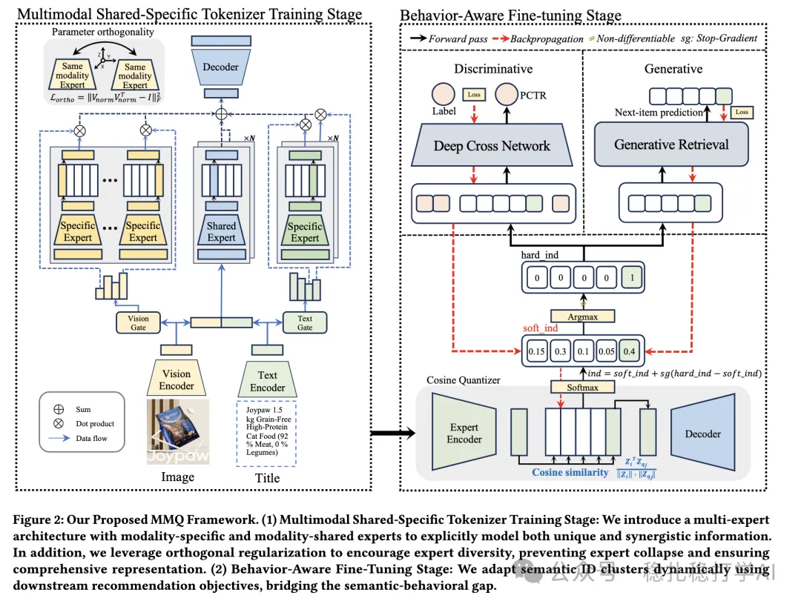

# 推荐算法(2025.9.15)：阿里的多模态MMOE版RQ-VAE

> 原文：https://mp.weixin.qq.com/s/Zhc2iFumX3OGIN_grUqyYw
> 作者：算法工程师刘明星（稳扎稳打学AI）| 发表于 2025-09-15

嘿，记得给“稳扎稳打学AI”添加星标

关注我，每天为你精挑细选最优质、最新鲜的推荐算法paper，陪你一起保持进步、不断精进！

> [English version](2025-09-15-ali-mmq-multimodal-rqvae.full.en.md)

👆 [本公众号paper推荐原则](https://mp.weixin.qq.com/s/BhVGu0qH5kTz9N5zpsD3KA)

1 MMQ: Multimodal Mixture-of-Quantization Tokenization for Semantic ID Generation and User Behavioral Adaptation

网址：https://arxiv.org/pdf/2508.15281

公司：阿里

方向：多模态

解读：

就是用不同的expert分别做codebook，来表达多模态的不同信息。先用共享的expert和特定的expert分开提取表征，然后通过对比学习和重建任务训练，最后通过行为数据微调，使codebook更适应推荐任务。

（1）共享与特定专家

共享专家：提取所有模态共有的信息。

特定专家：提取每个模态独有的信息。

（2）训练

通过对比学习和重建任务，训练共享专家和特定专家。具体的：对比学习用于对齐不同模态的表征，重建任务用于保留原始信息。

（3）行为微调

在推荐任务上，通过行为数据微调codebook，使其更适应推荐任务。具体的：用用户的行为数据，微调codebook，从而提升推荐效果。

AB：流量 10%，广告收入 +0.90%、CVR +4.33%、订单 +3.52%。

心得：（1）本文的思路非常简单直接：用不同的expert分别做codebook，来表达多模态的不同信息。这种方法的好处是：可以在不增加太多计算量的情况下，提升多模态的效果。（2）本文的共享专家和特定专家也非常值得借鉴。共享专家可以提取所有模态共有的信息，而特定专家可以提取每个模态独有的信息。

愚见：空

可信度：生产

推荐等级：推荐看看

请帮忙点赞、转发，谢谢。

## 欢迎干货投稿 \ 论文宣传 \ 合作交流

推荐您继续阅读：

■ [推荐算法(2025.9.11)：字节的双塔召回，行为序列与item可以做交叉，效果显著](https://mp.weixin.qq.com/s/x8pMwhZRTvJuqwvlWt4Onw)

■ [推荐算法(2025.9.10)：阿里的会话生成式推荐，召回效果显著](https://mp.weixin.qq.com/s/_o--mIENrTLr123_9KCFCA)

历史文章索引：https://docs.qq.com/sheet/DYXZTZ0tseHRyZGtt?tab=BB08J2

请入微信群，群内我会给出更深入的解读，还可以共同讨论技术方案、发招聘广告、内推和交友等。

• 铁粉标准：关注一个月以上，且累计10次互动（评论、爱心、转发）、或投稿1次。

• 入群方法：请您加个人微信lmxhappy，我拉您入群，请备注（只我个人看，不公开）。

喜欢的话点个在看吧👇

个人观点，仅供参考
