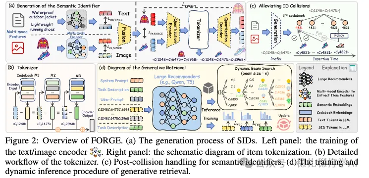

# Recommendation Papers (2025.9.26): Alibaba's complete solution for semantic IDs in generative recommendation

> [中文版](2025-09-26-ali-forge-sid.md)

1 FORGE: A Full-Pipeline Approach to Semantic ID Generation for Generative Retrieval

Link: https://arxiv.org/pdf/2509.20904v1

Company: Alibaba

Area: generative recommendation + semantic IDs

Idea: semantic ID generation (multimodal, quantization, collision resolution, dynamic inference)

Overview:

This paper gives a complete solution for generating semantic IDs in generative recommendation. Specifically:

(1) Semantic ID generation

As shown in the figure below, the RQ-VAE that generates SIDs takes multimodal information (text, images) as input. Each goes through its own encoder, then through fusion to get a fused representation, which then goes through the RQ-VAE to get the SID.

(2) Collision resolution

Multiple items may get the same SID, and the paper proposes a collision resolution method. Specifically: colliding items are reassigned SIDs according to certain rules. For example: if two items have the same SID, add 1 to the last digit of one item's SID to get a new SID.

(3) Generative retrieval

The user's behavior history sequence is fed into a generative model to generate the SID of the next item. Specifically: every item in the user's behavior history has an SID; these SIDs are fed into a generative model to generate the next item's SID; then the corresponding items are retrieved by the generated SID.

(4) Dynamic inference

At inference time, the paper also proposes a dynamic inference method. Specifically: the generative model's parameters are adjusted dynamically based on the user's behavior history sequence, improving retrieval performance.

A/B: on Alibaba ads, CTR +1.5% over the baseline.

Takeaways: (1) The idea of this paper is very simple and direct: it gives a complete solution for semantic ID generation in generative recommendation. The benefit is that it can improve generative recommendation without adding much computation. (2) The collision resolution and dynamic inference methods are also well worth borrowing. Collision resolution handles multiple items getting the same SID, and dynamic inference adjusts model parameters dynamically based on the user's behavior history sequence.

Caveats: none

Credibility: production

Recommendation: practically useful

