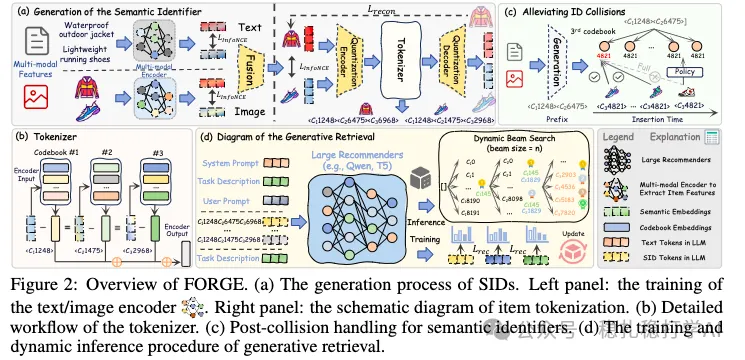

# 推荐算法(2025.9.26)：阿里的生成式推荐语义ID的完整解决方案

> 原文：https://mp.weixin.qq.com/s/-HBh2xhr55VfsNaTffI7VQ
> 作者：算法工程师刘明星（稳扎稳打学AI）| 发表于 2025-09-26

嘿，记得给“稳扎稳打学AI”添加星标

关注我，每天为你精挑细选最优质、最新鲜的推荐算法paper，陪你一起保持进步、不断精进！

> [English version](2025-09-26-ali-forge-sid.full.en.md)

👆 [本公众号paper推荐原则](https://mp.weixin.qq.com/s/BhVGu0qH5kTz9N5zpsD3KA)

1 FORGE: A Full-Pipeline Approach to Semantic ID Generation for Generative Retrieval

网址：https://arxiv.org/pdf/2509.20904v1

公司：阿里

方向：生成式推荐+语义ID

思想：语义ID生成（多模态、量化、冲突解决、动态推理）

解读：

本文主要是对生成式推荐的语义ID生成，给出了一个完整的解决方案。具体的：

（1）语义ID生成

如下图，生成SID的RQ-VAE，输入是多模态信息（文本、图像），经过各自的encoder，再经过fusion，得到一个融合的表征，再经过RQ-VAE，得到SID。

（2）冲突解决

多个物品可能生成相同的SID，本文提出了一个冲突解决的方法。具体的：将冲突的物品，按照一定的规则，重新分配SID。举一个例子：如果两个物品的SID相同，那么将其中一个物品的SID的最后一位，加1，从而得到一个新的SID。

（3）生成式召回

用户的历史行为序列，输入到一个生成式模型中，生成下一个物品的SID。具体的：用户历史行为序列中的每个物品，都有一个SID；将这些SID输入到一个生成式模型中，生成下一个物品的SID；然后，根据生成的SID，召回对应的物品。

（4）动态推理

在推理的时候，本文还提出了一个动态推理的方法。具体的：根据用户的历史行为序列，动态调整生成式模型的参数，从而提升召回的效果。

AB：在阿里广告上，相比基线，CTR +1.5%。

心得：（1）本文的思路非常简单直接：对生成式推荐的语义ID生成，给出了一个完整的解决方案。这种方法的好处是：可以在不增加太多计算量的情况下，提升生成式推荐的效果。（2）本文的冲突解决和动态推理方法也非常值得借鉴。冲突解决可以解决多个物品生成相同SID的问题，而动态推理可以根据用户的历史行为序列，动态调整模型的参数。

愚见：空

可信度：生产

推荐等级：有实践价值

请帮忙点赞、转发，谢谢。

## 欢迎干货投稿 \ 论文宣传 \ 合作交流

推荐您继续阅读：

■ [推荐算法paper](https://mp.weixin.qq.com/s?__biz=MzkzNDYyNjM1NA==&mid=2247484024&idx=1&sn=b6c0bc04592d62da52ce1cfe36e84d1a&scene=21#wechat_redirect)

历史文章索引：https://docs.qq.com/sheet/DYXZTZ0tseHRyZGtt?tab=BB08J2

请入微信群，群内我会给出更深入的解读，还可以共同讨论技术方案、发招聘广告、内推和交友等。

• 铁粉标准：关注公众号一个月以上，且在公众号上累计10次互动（评论、爱心、转发）、或投稿1次。

• 入群方法：请您加个人微信lmxhappy，我拉您入群，请备注（只我个人看，不公开）。

喜欢的话点个在看吧👇

个人观点，仅供参考
