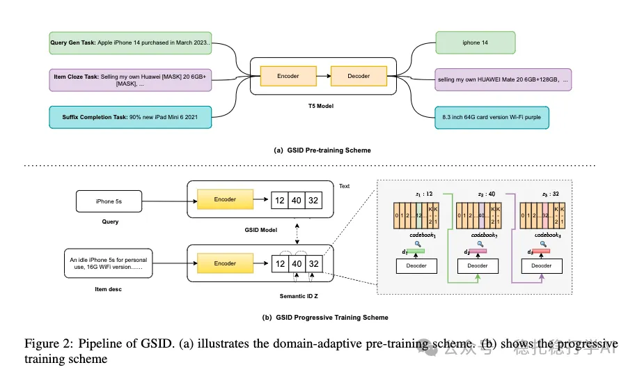

# Recommendation Papers (2025.10.1): Alibaba's model-based item tagging method, with very good results

> [中文版](2025-10-01-ali-gsid-xianyu.md)

1 GSID: Generating Semantic ID to Organize Products for E-commerce Recommendation

Link: https://arxiv.org/pdf/2509.23860

Company: Alibaba (Xianyu)

Idea: semantic IDs (vector quantization, generative, tagging) + multi-task

Area: generative recommendation

Overview:

This paper is mainly about tagging e-commerce products.

(1) Model. A product's semantic ID (i.e. its tag) is generated by a model with an encoder-decoder structure: the encoder's input is the product's text description, and the decoder's output is the product's semantic ID.

(2) Training. Not end-to-end; it has two steps:

1) Pretraining. First, pretrain on a large amount of product text descriptions. Specifically: a T5 model is pretrained on product text descriptions. Pretraining tasks include product category prediction, product attribute prediction, product title completion, etc.

2) Progressive training. Then, on top of the pretrained T5 model, do progressive training. Specifically: the product's semantic ID is split into several parts, generated step by step. For example: a product's semantic ID has 3 parts; the first is the product's category, the second its attributes, the third other information. During training, the first part is trained first, then the second, and finally the third.

Uses: the resulting tags can be used for retrieval and ranking. Specifically:

(1) Retrieval. The product's semantic ID can serve as the retrieval key and the user's semantic ID as the retrieval query, enabling retrieval.

(2) Ranking. The product's semantic ID can be fed into the ranking model as a feature, improving ranking performance.

A/B: on Xianyu, both retrieval and ranking improved. Specifically: retrieval hit rate +10%, ranking CTR +5%.

Takeaways: (1) This paper does not quantize the encoder's output but the decoder's output. The underlying reason is that the encoder compresses the original information, while the decoder is a cross-space mapping. The goal of this paper is the (description, category) mapping.

Caveats: none

Credibility: production

Recommendation: practically useful

