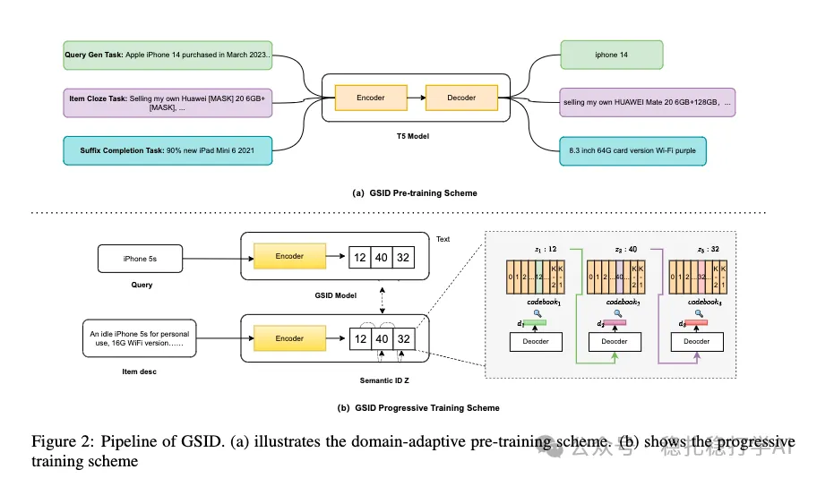

# 推荐算法(2025.10.1)：阿里的模型打标签方法，效果很不错

> 原文：https://mp.weixin.qq.com/s/csPTTnmGkTxiZ59fEziikg
> 作者：算法工程师刘明星（稳扎稳打学AI）| 发表于 2025-10-01

嘿，记得给“稳扎稳打学AI”添加星标

关注我，每天为你精挑细选最优质、最新鲜的推荐算法paper，陪你一起保持进步、不断精进！

👆 [本公众号paper推荐原则](https://mp.weixin.qq.com/s/BhVGu0qH5kTz9N5zpsD3KA)

1 GSID: Generating Semantic ID to Organize Products for E-commerce Recommendation

网址：https://arxiv.org/pdf/2509.23860

公司：阿里（闲鱼）

思想：语义ID（向量量化、生成式、打标签）+多任务

方向：生成式推荐

解读：

本文主要是对电商商品打标签。

（1）模型。商品的语义ID（即标签），是用一个模型生成的，该模型是一个encoder-decoder结构，encoder的输入是商品的文本描述，decoder的输出是商品的语义ID。

（2）训练。不是端对端的，分成两步：

1）预训练。首先，在大量的商品文本描述上，做预训练。具体的：用一个T5模型，在商品文本描述上，做预训练。预训练的任务包括：商品类别预测、商品属性预测、商品标题补全等。

2）渐进训练。其次，在预训练的T5模型基础上，做渐进训练。具体的：将商品的语义ID，分成多个部分，逐步生成。举一个例子：商品的语义ID有3个部分，第一部分是商品的类别，第二部分是商品的属性，第三部分是商品的其它信息。在训练的时候，先训练第一部分，再训练第二部分，最后训练第三部分。

用处：打出来的标签，可以用于召回和排序。具体的：

（1）召回。商品的语义ID，可以作为召回的key，用户的语义ID，可以作为召回的query，从而实现召回。

（2）排序。商品的语义ID，可以作为排序的特征，输入到排序模型中，从而提升排序的效果。

AB：在闲鱼上，召回和排序的效果都有提升。具体的：召回的命中率提升了10%，排序的点击率提升了5%。

心得：（1）本文不是对encoder的输出作的量化，而是对decoder的输出做的。本质原因是encoder是对原始信息的压缩；decoder是一个跨空间的映射。本文的目的是（描述，category）的映射

愚见：空

可信度：生产

推荐等级：有实践价值

请帮忙点赞、转发，谢谢。

## 欢迎干货投稿 \ 论文宣传 \ 合作交流

推荐您继续阅读：

■ [推荐算法(2025.9.29)：阿里的子任务的知识迁移方法](https://mp.weixin.qq.com/s/rD39A0g6Y5bewV1ahWLMvA)

■ [推荐算法(2025.9.26)：阿里的生成式推荐语义ID的完整解决方案](https://mp.weixin.qq.com/s/-HBh2xhr55VfsNaTffI7VQ)

历史文章索引：https://docs.qq.com/sheet/DYXZTZ0tseHRyZGtt?tab=BB08J2

请入微信群，群内我会给出更深入的解读，还可以共同讨论技术方案、发招聘广告、内推和交友等。

• 铁粉标准：关注公众号一个月以上，且在公众号上累计15次互动（评论、爱心、转发）、或投稿1次。

• 入群方法：请您加个人微信lmxhappy，我拉您入群，请备注（只我个人看，不公开）。

喜欢的话点个在看吧👇

个人观点，仅供参考
