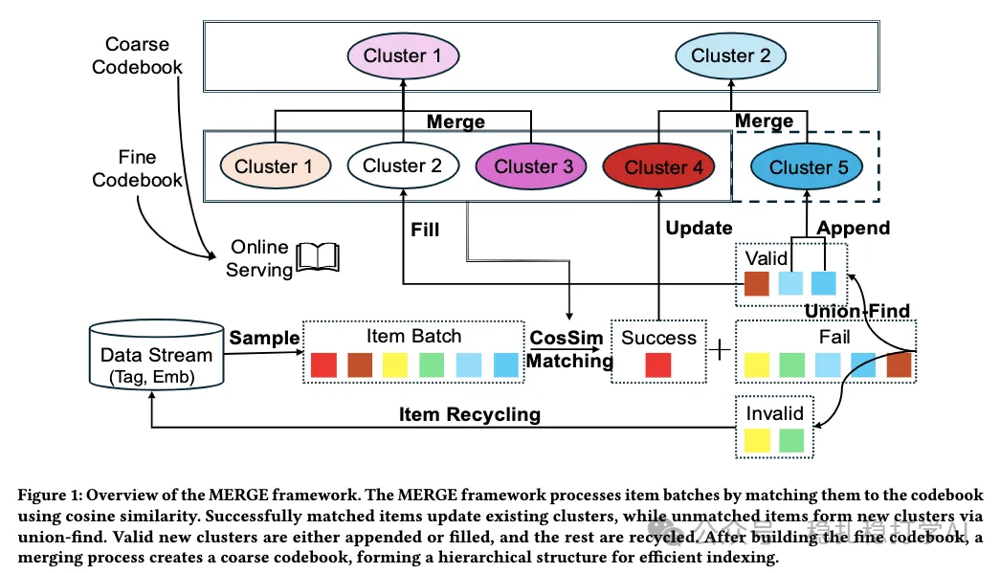

# Recommendation Papers (2026.1.30): ByteDance, an innovative semantic ID generation method

> [中文版](2026-01-29-bytedance-merge-sid.md)

1 MERGE: A Framework for Dynamic Codebook Maintenance of Semantic IDs for Generative Recommendation

Link: https://arxiv.org/pdf/2601.19626

Company: ByteDance

Area: semantic IDs

Overview:

This work tackles cold start and dynamic updating of semantic IDs, and can be seen as an important exploration by ByteDance in the semantic ID direction.

The semantic ID generation method here has 3 main parts:

(1) Maintaining a dynamic codebook

The dynamic codebook is maintained as follows:
1. Extract representations (embeddings) of all items
2. Compute the similarity between items and each cluster center
3. Assign each item to the cluster whose center is most similar
4. If a cluster's item count exceeds a threshold, split the cluster
5. If a cluster's item count is below a threshold, merge the cluster

(2) Cluster quality monitoring

The method monitors each cluster's quality and acts accordingly:

- Clusters whose intra-cluster similarity is below a threshold are broken up.
- Two or more clusters that are highly similar to each other are merged.
- Outliers: items that find no matching cluster are put into a staging area.
- Each item tries to match at most K times; after K attempts it is thrown into the staging area.

(3) Grouped merging of fine codebooks

The method groups the fine codebooks and merges within groups, not across groups. Specifically:

- Group the fine codebooks by similarity
- Merge within groups, not across groups
- Recompute cluster centers for the merged codebook

Takeaways:
(1) Keep polishing the semantic ID generator; once it is polished to the point where it works really well, you get the gains.

Credibility: production

Recommendation: recommended
