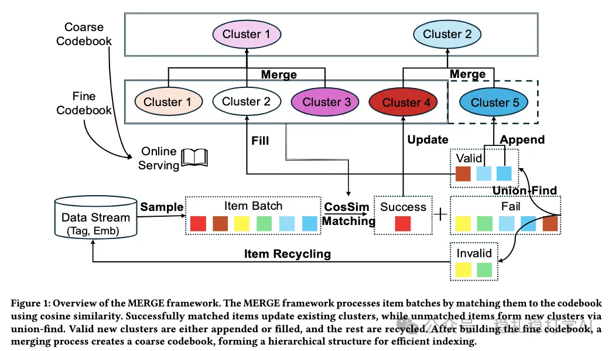

# 推荐算法(2026.1.30)：字节，创新的语义ID生成方法

> 原文：https://mp.weixin.qq.com/s/Ts8VSDhJPCRPzdK4skr1qQ
> 作者：算法工程师刘明星（稳扎稳打学AI）| 发表于 2026-01-29（标题已修改；修改于2026年1月29日）

嘿，记得给“稳扎稳打学AI”添加星标

关注我，每天为你精挑细选最优质、最新鲜的推荐算法paper，陪你一起保持进步、不断精进！

> [English version](2026-01-29-bytedance-merge-sid.full.en.md)

👆 [本公众号paper推荐原则](https://mp.weixin.qq.com/s/BhVGu0qH5kTz9N5zpsD3KA)

1 MERGE: A Framework for Dynamic Codebook Maintenance of Semantic IDs for Generative Recommendation

网址：https://arxiv.org/pdf/2601.19626

公司：字节

方向：语义ID

解读：

这篇工作解决了语义ID冷启动和动态更新的问题，可以说是字节在语义ID方向的一次重要探索。

这里的语义ID生成方法，主要包括3个部分：

（1）维护动态码本

动态码本维护的方法如下：
1. 提取所有物品的表征（embedding）
2. 计算物品与各簇中心的相似度
3. 将相似度最高的簇中心对应的物品，分配给该簇
4. 如果该簇的物品数量超过阈值，则拆分该簇
5. 如果该簇的物品数量小于阈值，则合并该簇

（2）簇质量监控

方法会监控每个簇的质量，并采取相应的措施：

- 簇内相似度小于阈值的簇，拆掉。
- 有两个以上的簇互相相似度很高，合并。
- 孤立点：没有找到匹配簇的物品，放到临时区。
- 每个item最多尝试匹配K次，超过K次后就扔到临时区。

（3）细码本的分组合并

方法将细码本进行分组，组内合并，组间不合并。具体做法是：

- 按相似度对细码本进行分组
- 组内合并，组间不合并
- 合并后的码本，重新计算簇中心

心得：
（1）慢慢打磨语义ID生成器，打磨的非常趁手，就能拿到收益。

可信度：生产

推荐等级：推荐看看

请帮忙点赞、转发，谢谢。

## 欢迎干货投稿 \ 论文宣传 \ 合作交流

推荐您继续阅读：

[推荐算法(2026.1.29)：Meta，离线长序列建模，转化率+4.3%](https://mp.weixin.qq.com/s/cV_f_kaFIhi-fwazrhRW7w)

[推荐算法(2026.1.26)：阿里，后推荐召回居然用上了排序模型，转化+1%](https://mp.weixin.qq.com/s/aXnARzxBImS6HzhbJMnhGw)

历史文章索引：https://docs.qq.com/sheet/DYXZTZ0tseHRyZGtt?tab=BB08J2

请入微信群，群内我会给出更深入的解读，还可以共同讨论技术方案、发招聘广告、内推和交友等。

铁粉标准：关注公众号一个月以上，且在公众号上累计15次互动（评论、爱心、转发）、或投稿1次，只欢迎技术同学。

入群方法：请您加个人微信lmxhappy，我拉您入群，请备注（只我个人看，不公开）。

喜欢的话点个在看吧👇

个人观点，仅供参考

修改于2026年1月29日
