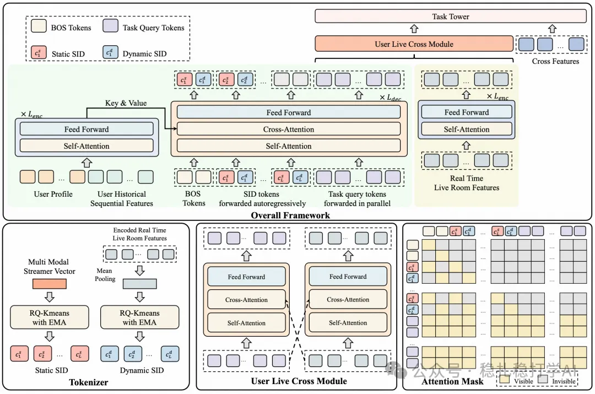
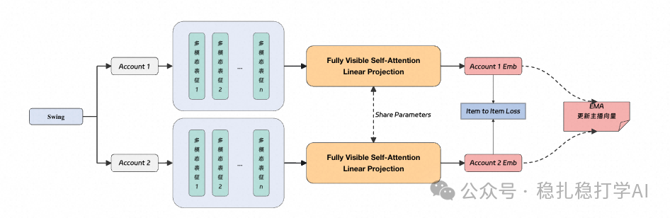
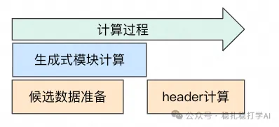
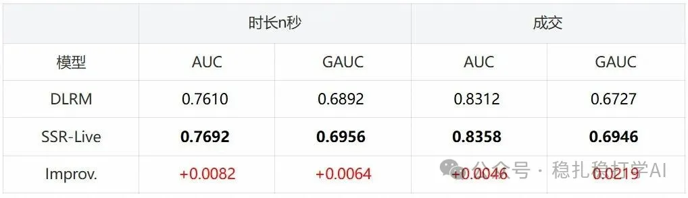
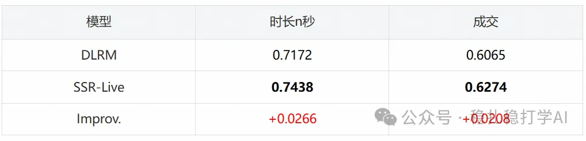
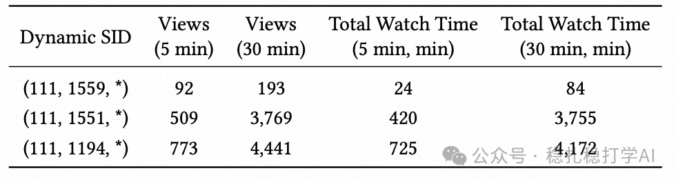
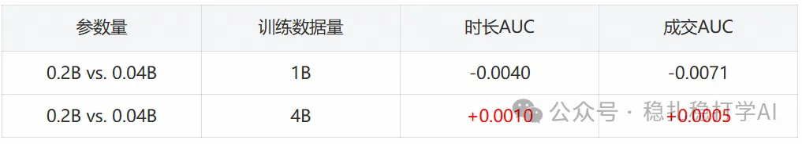

# Taobao Live SSR-Live: dynamic semantic IDs help the model reason, catching a live room's highlight moments instantly

> [中文版](2026-03-04-taobao-ssr-live.md)

> Note: reprinted article. Original source: Taotian Group Intelligent Algorithm Products (淘天集团智能算法产品), authors: Taotian Live algorithm team. Formulas in the body are transcribed from the math rendered on the page, and the contents of table images are given as Markdown tables after the corresponding images.

The following article is from Taotian Group Intelligent Algorithm Products. Author: Taotian Live algorithm team


## 1. Background

In recent years, multimodal large language models (MLLMs) have become an important tool for open-world recommendation problems. Through image-text multimodal fusion, modeling of temporal dynamics and the like, models can more precisely track real-time content changes in live rooms, improving user experience and recommendation performance. How to use this multimodal information efficiently is key to improving live-stream recommendation.

However, current uses of MLLMs in live-stream recommendation still have many shortcomings. On one hand, existing video content understanding methods usually provide semantic information through offline frame sampling and generating video descriptions or tags, which cannot capture a live room's rapidly changing content. On the other hand, MLLM features are usually used only as extra features or pre-ranking features, without deep fusion with the main model, so the model's potential is hard to fully unlock.

To address this, we propose SSR-Live, a dynamic-semantic-ID-guided streaming recommendation model for live streams. SSR-Live parses live room content in real time and converts it into Dynamic Semantic IDs. These dynamic SIDs, together with multimodal SIDs, give the model real-time semantic information, and a generative architecture explicitly brings these semantic IDs into the recommendation model's reasoning process, significantly improving recommendation performance.

The main contributions are:

- Dynamic Semantic ID: an end-to-end learnable codebook that generates dynamic SIDs for live rooms in real time, letting the model perceive changes in live room content in real time.
- Generative Reasoning Architecture: multimodal SIDs and dynamic SIDs serve as the model's explicit reasoning process, guiding the model's reasoning and thereby improving recommendation performance.
- Multi-Task Discriminative Header: on top of generative reasoning, combined with a multi-task learning framework, optimizing several business objectives at once.

## 2. Method

### 1. Overall design

### 1.1 Multimodal semantic IDs

A multimodal SID is a semantic identifier generated and quantized by a multimodal large model. By analyzing the live room's visual and text information, it produces content-related multimodal semantic identifiers. Multimodal SIDs help capture the diversity of live room content and help the model better understand and tell apart different live rooms.

Concretely, multimodal SIDs are generated as follows:

- First sample frames from the live room video stream to get live room images.
- Use a multimodal large model to encode the live room's images and text into a visual vector and a text vector, respectively.
- Fuse the visual vector and text vector into a combined multimodal vector.
- Quantize that vector with an end-to-end learnable codebook to produce the multimodal SID.

Semantic levels of the multimodal SID:

- Category: women's shoes, men's clothing, etc.
- Subcategory: ankle boots, sneakers, etc.
- Product details: e.g. flats, black, high heels.

### 1.2 Dynamic semantic IDs

Dynamic SIDs are generated from real-time data and reflect moment-to-moment changes in the live room. Dynamic SIDs are aligned with multimodal SIDs so the model can capture the live room's real-time dynamics.

Dynamic SID generation has these steps:

- A multimodal large model processes live room content (images and text) in real time to produce a vector representation of the live room content.
- That vector is used to generate an SID dynamically; the SID changes as the live room content changes.
- The dynamic SID is aligned with the multimodal SID, producing the dynamic SID used for reasoning in the model input.

Aligning dynamic SIDs with multimodal SIDs:

- The dynamic SID is aligned with the multimodal SID to keep the two consistent in semantic space, so the model can reason using both SIDs together.
- The alignment between dynamic and multimodal SIDs is implemented with exponential moving average (EMA).

### 1.3 Generative recommendation

In the generative module, we use an Encoder-Decoder structure to generate the multimodal SID and the dynamic SID as the model's explicit reasoning process. The dynamic SID not only changes in real time with the live room content, but its semantic space can also be updated as the model trains, continually adjusting through end-to-end optimization to adapt to the dynamic changes of live room content.

In the decoder, we use a Transformer Decoder structure, whose input is the multimodal SID and the dynamic SID and whose output is the model's prediction. The decoder input includes:

- The BOS tokens for the multimodal SID and the dynamic SID, plus the multimodal SID and dynamic SID themselves.
- Learnable queries assigned to each task, where T is the number of tasks and Q is the number of queries per task.

The decoder input is:

```
DecInput = {[[BOS]s, [BOS]d], [c1^s, c1^d], …, [cL^s, cL^d], [q1^1, …, qQ^1, …, q1^T, …, qQ^T]}
```

It contains, respectively:

1) The BOS tokens for the multimodal SID and the dynamic SID [[BOS]s, [BOS]d], plus the multimodal SID [c1^s, c2^s, …, cL^s] and the dynamic SID [c1^d, c2^d, …, cL^d].
2) Learnable queries assigned to each task [q1^1, …, qQ^1, …, q1^T, …, qQ^T], where T is the number of tasks and Q is the number of queries per task.

SSR-Live can not only use the reasoning ability of the generative model, reasoning through the dynamic SID and multimodal SID, but can also do multi-task optimization through the discriminative model, ensuring recommendation accuracy and stability.



### 2. SID construction

### 2.1 Building dynamic SIDs for live rooms

Dynamic SIDs are built with an end-to-end learnable codebook, generated from real-time data. The codebook is updated with exponential moving average (EMA), as follows:

```
N_c^(t) = γ N_c^(t-1) + (1-γ) B
m_c^(t) = γ m_c^(t-1) + (1-γ) Σ_{b=1}^B h_v^b
e_c^(t) = m_c^(t) / N_c^(t)
```

The dynamic SID not only changes in real time with the live room content, but its semantic space can also be updated as the model trains, continually adjusting through end-to-end optimization to adapt to the dynamic changes of live room content.

### 2.2 Multimodal SIDs for live rooms



Multimodal SIDs are equally important. They are generated by a multimodal large model and capture the diversity of live room content. Multimodal SIDs are built much like dynamic SIDs, quantized with an end-to-end learnable codebook.

### 3. Model architecture

### 3.1 Generative module

The generative module uses an Encoder-Decoder structure: the encoder processes the multimodal SID and dynamic SID, and the decoder generates the model's prediction. The generative module's reasoning process is explicit; the model can reason through the SID sequence.

### 3.2 Multi-task discriminative header

The multi-task discriminative header builds on generative reasoning and, combined with a multi-task learning framework, optimizes several business objectives at once. Its input is the output of the generative module; through the multi-task learning framework, the model can simultaneously optimize watch time, purchases, interactions and other objectives.

## 4. Model training

### 4.1 Generation task

Multimodal SID computation:
Dynamic SID computation:
Generative training supervises the model's explicit reasoning process, treating the SID sequence as the model's chain of thought. The loss is:

```
ℒ_NTP = -1/L Σ_{i=3}^{2+2L} { log P(c^d_{⌊i/2⌋-1} | DecInput_{<i}), i mod 2 = 0; log P(c^s_{⌊i/2⌋} | DecInput_{<i}), i mod 2 = 1 }
```

### 4.2 Discriminative task

The discriminative task is optimized with standard binary cross-entropy loss, where y is the task label and ŷ is the predicted probability output by the model.

```
ℒ_task = -[y log(ŷ) + (1-y) log(1-ŷ)]
```

The multi-task loss is:

```
ℒ_MTL = w_time · ℒ_time + w_int · ℒ_int + w_ord · ℒ_ord + …
```

We also model the ranking objective as a softmax loss:

```
ℒ_top_k = -log( (Σ_{i∈POS} exp(s_i)) / (Σ_{j∈ALL} exp(s_j)) )
```

where s_i, s_j are logits output by the model, and ALL and POS are the candidate set and the subset of positive samples in the candidate set, respectively.

The ranking loss is:

```
ℒ_rank = w_top_a * ℒ_top_a + w_top_b * ℒ_top_b + …
```

The total loss is:

```
ℒ = ℒ_MTL + λ_rank * ℒ_rank
```

## 5. Online inference

### 5.1 Real-time inference flow

During online inference, the model receives live room content in real time, generates dynamic SIDs, and reasons together with multimodal SIDs. Inference is streaming, so the model can update recommendation results in real time.

### 5.2 Engineering optimization

Engineering optimizations for online inference include model quantization, operator fusion, cache optimization and so on. With these, the model meets the online inference latency requirements while preserving its quality.



## 3. Experiments and evaluation

### 1. Results

### 1.1 Offline evaluation

SSR-Live outperforms the online pre-ranking baseline DLRM on offline metrics.



(Transcription of the table in the image above:)

| Model | Watch n sec AUC | Watch n sec GAUC | Purchase AUC | Purchase GAUC |
|---|---|---|---|---|
| DLRM | 0.7610 | 0.6892 | 0.8312 | 0.6727 |
| SSR-Live | 0.7692 | 0.6956 | 0.8358 | 0.6946 |
| Improv. | +0.0082 | +0.0064 | +0.0046 | +0.0219 |

### 1.2 Online evaluation

In the Mobile Taobao vertical-swipe feed (including product explanation segments): views +1.89%, watch time +3.38%, purchase orders +2.36%, purchasing users +0.35%, following users +3.12%, interacting users +2.92%.

Online Hit Rate (recall) improvement for each objective:



(Transcription of the image above:)

| Model | Watch n sec Hit Rate | Purchase Hit Rate |
|---|---|---|
| DLRM | 0.7172 | 0.6065 |
| SSR-Live | 0.7438 | 0.6274 |
| Improv. | +0.0266 | +0.0208 |

### 2. SID case analysis

### 2.1 Dynamic SIDs

The table below shows how the dynamic SID of the same streamer changes at different points in time. As the live room's popularity changes, the dynamic SID keeps changing, reflecting real-time changes in the live room's content.



(Transcription of the table in the image above:)

| Dynamic SID | Views (5 min) | Views (30 min) | Total Watch Time (5 min, min) | Total Watch Time (30 min, min) |
|---|---|---|---|---|
| (111,1559,*) | 92 | 193 | 24 | 84 |
| (111,1551,*) | 509 | 3769 | 420 | 3755 |
| (111,1194,*) | 773 | 4441 | 725 | 4172 |

As the live room's popularity changes, the dynamic SID keeps changing. Dynamic SIDs reflect changes in live room content in real time, helping the model better understand the live room's current state.

### 2.2 Multimodal SIDs

The figures below show the multimodal SIDs of different types of streamers. Different types of streamers have different multimodal SIDs, reflecting the diversity of live room content.


### 3. Scaling analysis

We analyzed models with different parameter counts, as shown in the table below.



(Transcription of the table in the image above:)

| Comparison | Training data size | Watch time AUC | Purchase AUC |
|---|---|---|---|
| 0.2B vs. 0.04B | 1B | -0.0040 | -0.0071 |
| 0.2B vs. 0.04B | 4B | +0.0010 | +0.0005 |

## 4. Summary

Through dynamic semantic IDs and a generative reasoning architecture, SSR-Live significantly improves live-stream recommendation. Dynamic SIDs reflect changes in live room content in real time, the generative reasoning architecture explicitly brings semantic information into the model's reasoning process, and the multi-task discriminative header optimizes several business objectives at once.

Going forward, we will keep exploring dynamic semantic IDs in more scenarios to further improve recommendation performance.

Thanks for reading.

<!-- The original has an illustration here; the page did not expose its image URL, so it could not be saved -->
