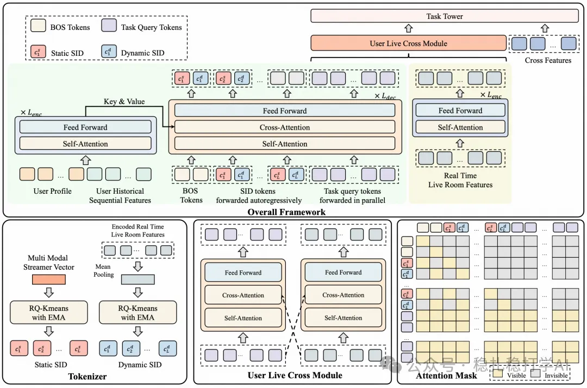
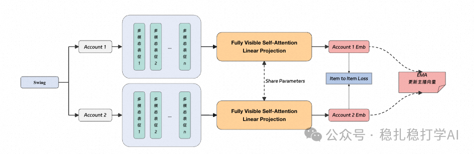
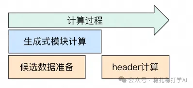
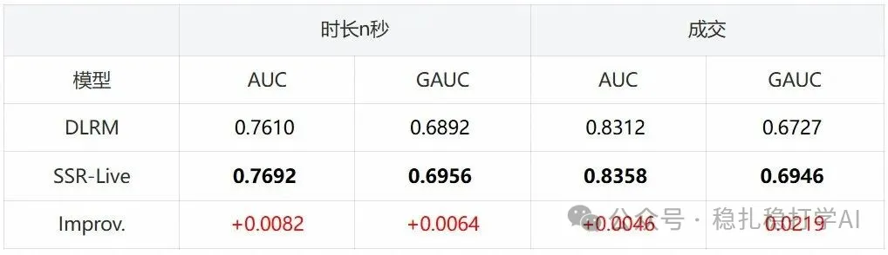
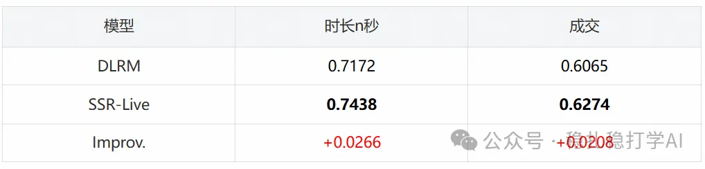
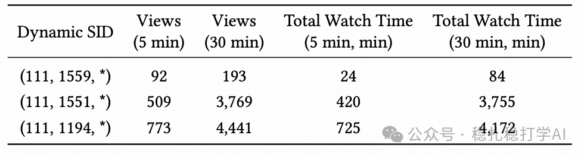
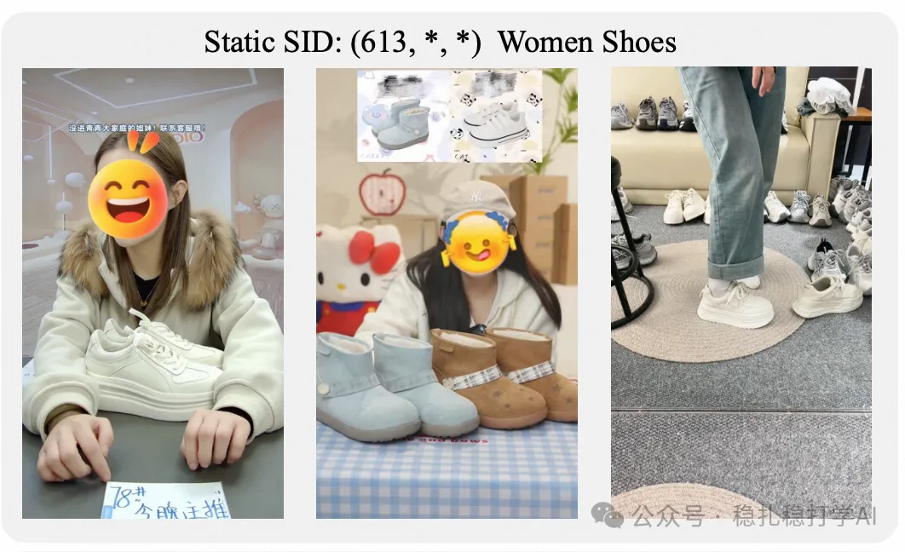
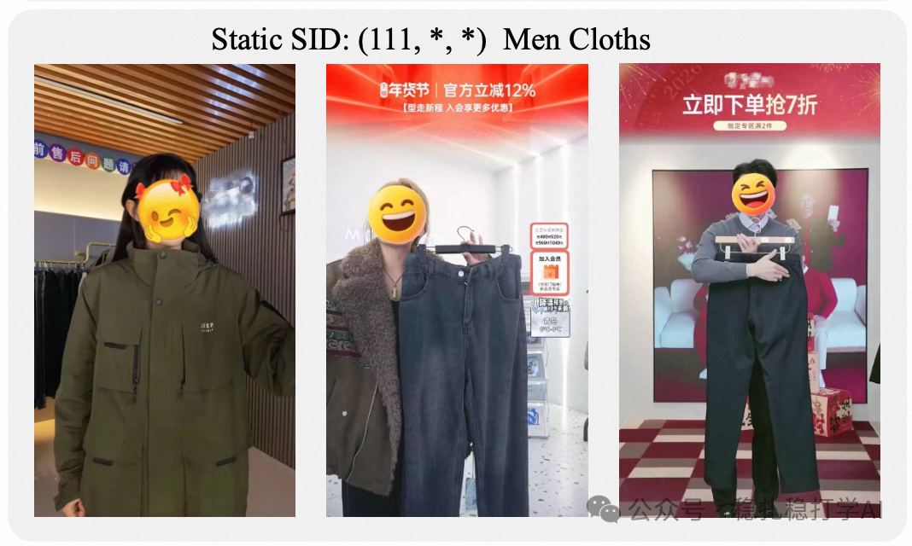
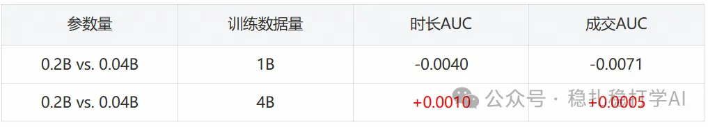

# 淘宝直播SSR-Live：动态语义ID助力模型推理，秒懂直播间精彩瞬间

> [English version](2026-03-04-taobao-ssr-live.full.en.md)

> 原文：https://mp.weixin.qq.com/s/nu9wHb9-0SRr8Esw7iFPYg
> 稳扎稳打学AI 转载 | 发表于 2026-03-04
> 备注：转载文章，原出处「淘天集团智能算法产品」，作者：淘天直播算法团队；该文在公众号页面显示为「仅自己可见」。正文公式由页面渲染的数学公式转写，表格图片的内容另以 Markdown 表格附在对应图片之后。

The following article is from 淘天集团智能算法产品 Author 淘天直播算法团队


## 一、背景

近年来，多模态大模型（MLLM）已成为解决开放世界推荐问题的重要工具。通过图文多模态融合、时间动态信息建模等方式，模型能够更精准地把握直播间的实时内容变化，优化用户体验和推荐效果。如何高效利用这些多模态信息，是提升直播推荐效果的关键。

然而，现有直播推荐中MLLM的应用仍存在诸多不足。一方面，现有的视频内容理解方法，通常通过离线抽帧、生成视频描述或标签来提供语义信息，但这种方式无法捕捉直播间瞬息万变的内容。另一方面，MLLM特征通常只是作为附加特征或粗排特征使用，缺乏与主模型的深度融合，难以充分释放模型潜力。

为此，本文提出SSR-Live，这是一个动态语义ID引导的直播流式推荐模型。SSR-Live能够实时解析直播间内容，并将其转化为动态语义ID（Dynamic Semantic ID）。这些动态SID与多模态SID一起，为模型提供实时的语义信息，并通过生成式架构将这些语义ID显式地融入推荐模型的推理过程，从而显著提升推荐效果。

本文的主要贡献包括：

- 动态语义ID（Dynamic Semantic ID）：提出了一种端到端可学习码本，实时为直播间生成动态SID，使模型能够实时感知直播间的内容变化。
- 生成式推理架构（Generative Reasoning Architecture）：将多模态SID与动态SID作为模型的显式推理过程，引导模型推理，从而提升推荐效果。
- 多任务判别式头（Multi-Task Discriminative Header）：在生成式推理的基础上，结合多任务学习框架，同时优化多个业务目标。

## 二、方法

### 1. 整体方案

### 1.1 多模态语义ID

多模态SID是由多模态大模型生成并量化的语义标识，通过分析直播间的视觉与文本信息，生成内容相关的多模态语义标识。多模态SID有助于捕捉直播间内容的多样性，帮助模型更好地理解和区分不同的直播间。

具体地，多模态SID通过以下步骤生成：

- 首先对直播间视频流进行抽帧处理，得到直播间图像。
- 使用多模态大模型，分别将直播间的图像和文本信息编码为视觉向量与文本向量。
- 将视觉向量与文本向量进行融合，得到综合的多模态向量。
- 将该向量通过端到端可学习码本进行量化，生成多模态SID。

多模态SID的语义层次：

- 品类：女鞋、男装等。
- 品类细分：短靴、运动鞋等。
- 商品细节：如平底鞋、黑色、高跟等。

### 1.2 动态语义ID

动态SID通过实时数据生成，能够反映直播间的瞬息变化。动态SID与多模态SID对齐，使模型能够捕捉直播间的实时动态。

动态SID生成包含以下步骤：

- 通过多模态大模型实时处理直播间内容（图像与文本信息），生成直播间内容的向量表示。
- 利用该向量动态生成SID，该SID会随着直播间内容的变化而变化。
- 动态SID与多模态SID对齐，生成模型输入中用于推理的动态SID。

动态SID与多模态SID对齐：

- 动态SID与多模态SID对齐，确保二者在语义空间内保持一致，模型能够利用这两个SID共同推理。
- 动态SID与多模态SID的对齐使用指数移动平均（EMA）方法实现。

### 1.3 生成式推荐

在生成式模块中，我们采用Encoder-Decoder结构来生成多模态SID和动态SID，作为模型的显式推理过程。动态SID不仅能随直播间内容实时变化，而且其语义空间也可以随模型训练更新，通过端到端优化不断调整，以适应直播间内容的动态变化。

在解码器中，我们采用Transformer Decoder结构，输入为多模态SID和动态SID，输出为模型的预测结果。Decoder的输入包括：

- 多模态SID和动态SID对应的BOS token，以及多模态SID和动态SID。
- 为每个任务分配的可学习的query，T表示任务个数，Q表示每个任务的query个数。

Decoder的输入为：

```
DecInput = {[[BOS]s, [BOS]d], [c1^s, c1^d], …, [cL^s, cL^d], [q1^1, …, qQ^1, …, q1^T, …, qQ^T]}
```

分别包含：

1）多模态SID和动态SID对应的BOS token [[BOS]s, [BOS]d]，以及多模态SID [c1^s, c2^s, …, cL^s]和动态SID [c1^d, c2^d, …, cL^d]。
2）为每个任务分配的可学习的query [q1^1, …, qQ^1, …, q1^T, …, qQ^T]，T表示任务个数，Q表示每个任务的query个数。

SSR-Live不仅能利用生成式模型的推理能力，通过动态SID与多模态SID的推理，还能通过判别式模型进行多任务优化，保证推荐的精度和稳定性。



### 2. SID构建

### 2.1 直播间动态SID的构建

动态SID的构建采用端到端可学习码本，通过实时数据生成动态SID。码本的更新采用指数移动平均（EMA）方法，具体公式如下：

```
N_c^(t) = γ N_c^(t-1) + (1-γ) B
m_c^(t) = γ m_c^(t-1) + (1-γ) Σ_{b=1}^B h_v^b
e_c^(t) = m_c^(t) / N_c^(t)
```

动态SID不仅能随直播间内容实时变化，而且其语义空间也可以随模型训练更新，通过端到端优化不断调整，以适应直播间内容的动态变化。

### 2.2 直播间多模态SID



多模态SID同样关键。多模态SID通过多模态大模型生成，捕捉直播间内容的多样性。多模态SID的构建与动态SID类似，采用端到端可学习码本进行量化。

### 3. 模型结构

### 3.1 生成式模块

生成式模块采用Encoder-Decoder结构，Encoder处理多模态SID和动态SID，Decoder生成模型的预测结果。生成式模块的推理过程是显式的，模型能够通过SID序列进行推理。

### 3.2 多任务判别式Header

多任务判别式Header在生成式推理的基础上，结合多任务学习框架，同时优化多个业务目标。判别式Header的输入为生成式模块的输出，通过多任务学习框架，模型能够同时优化观看时长、成交、互动等多个目标。

## 4. 模型训练

### 4.1 生成任务

多模态SID计算：
动态SID计算：
生成式训练可以监督模型的显式推理过程，将SID序列作为模型的思维链。损失函数如下：

```
ℒ_NTP = -1/L Σ_{i=3}^{2+2L} { log P(c^d_{⌊i/2⌋-1} | DecInput_{<i}), i mod 2 = 0; log P(c^s_{⌊i/2⌋} | DecInput_{<i}), i mod 2 = 1 }
```

### 4.2 判别任务

判别任务使用标准二分类交叉熵损失进行优化，其中 y 为任务标签，ŷ 为模型输出的预测概率。

```
ℒ_task = -[y log(ŷ) + (1-y) log(1-ŷ)]
```

多任务损失为：

```
ℒ_MTL = w_time · ℒ_time + w_int · ℒ_int + w_ord · ℒ_ord + …
```

我们将排序目标也建模为Softmax损失：

```
ℒ_top_k = -log( (Σ_{i∈POS} exp(s_i)) / (Σ_{j∈ALL} exp(s_j)) )
```

其中：s_i, s_j 为模型输出的logits，ALL, POS 分别代表候选集合和候选集合中的正样本子集。

排序损失为：

```
ℒ_rank = w_top_a * ℒ_top_a + w_top_b * ℒ_top_b + …
```

总损失为：

```
ℒ = ℒ_MTL + λ_rank * ℒ_rank
```

## 5. 在线推理

### 5.1 实时推理流程

在线推理时，模型实时接收直播间内容，生成动态SID，并结合多模态SID进行推理。推理过程是流式的，模型能够实时更新推荐结果。

### 5.2 工程优化

在线推理的工程优化包括模型量化、算子融合、缓存优化等。通过这些优化，模型能够在保证效果的同时，满足在线推理的延迟要求。



## 三、实验与评估

### 1. 实验结果

### 1.1 离线评估

SSR-Live离线指标上优于线上粗排基线DLRM。



（上图表格内容转写：）

| 模型 | 时长n秒 AUC | 时长n秒 GAUC | 成交 AUC | 成交 GAUC |
|---|---|---|---|---|
| DLRM | 0.7610 | 0.6892 | 0.8312 | 0.6727 |
| SSR-Live | 0.7692 | 0.6956 | 0.8358 | 0.6946 |
| Improv. | +0.0082 | +0.0064 | +0.0046 | +0.0219 |

### 1.2 在线评估

手淘上下滑(含讲解)，观看次数+1.89%， 观看时长 +3.38% ，成交笔数 +2.36% ，成交人数 +0.35% ，关注人数 +3.12% ，互动人数 +2.92%

在线各个目标的Hit Rate（召回率）提升：



（上图内容转写：）

| 模型 | 时长n秒 Hit Rate | 成交 Hit Rate |
|---|---|---|
| DLRM | 0.7172 | 0.6065 |
| SSR-Live | 0.7438 | 0.6274 |
| Improv. | +0.0266 | +0.0208 |

### 2. SID Case分析

### 2.1 动态SID

下表展示了同一主播在不同时间点的动态SID变化情况。可以看到，随着直播间热度的变化，动态SID也在不断变化，反映了直播间内容的实时变化。



（上图表格内容转写：）

| Dynamic SID | Views (5 min) | Views (30 min) | Total Watch Time (5 min, min) | Total Watch Time (30 min, min) |
|---|---|---|---|---|
| (111,1559,*) | 92 | 193 | 24 | 84 |
| (111,1551,*) | 509 | 3769 | 420 | 3755 |
| (111,1194,*) | 773 | 4441 | 725 | 4172 |

可以看到，随着直播间热度的变化，动态SID也在不断变化。动态SID能够实时反映直播间的内容变化，帮助模型更好地理解直播间的实时状态。

### 2.2 多模态SID

下图展示了不同类型主播的多模态SID。可以看到，不同类型的主播具有不同的多模态SID，反映了直播间内容的多样性。





### 3. Scaling分析

我们分析了不同参数量的模型效果，如下表。



（上图表格内容转写：）

| 对比 | 训练数据量 | 时长AUC | 成交AUC |
|---|---|---|---|
| 0.2B vs. 0.04B | 1B | -0.0040 | -0.0071 |
| 0.2B vs. 0.04B | 4B | +0.0010 | +0.0005 |

## 四、总结

SSR-Live通过动态语义ID和生成式推理架构，显著提升了直播推荐的效果。动态SID能够实时反映直播间的内容变化，生成式推理架构能够将语义信息显式地融入模型推理过程，多任务判别式Header能够同时优化多个业务目标。

未来，我们将继续探索动态语义ID在更多场景中的应用，进一步提升推荐效果。

感谢耐心阅读。

<!-- 原文此处有一张插图，页面未暴露其图片链接，无法存入 -->

关注「淘天集团智能算法产品」，一起成长～
