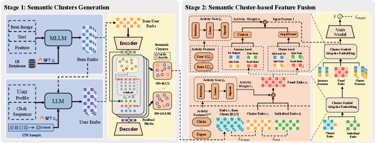

# Alibaba: adding cluster-related features, GMV +3%

> [中文版](alibaba-akt-rec.md)

### Paper: From Head to Tail: Asymmetric Knowledge Transfer in Long-tail Recommendation with Generative Semantic IDs
### Link: https://arxiv.org/pdf/2605.23310
### Company: Alibaba
### Idea: clustering, contrastive learning
### Area: feature engineering

## Overview:
On top of the existing features, it adds features about the clusters that the user and the target item belong to.

Concretely, the user and item representations are explicitly decomposed into a Cluster Embedding and an Individual Embedding, and contrastive learning plus an orthogonality regularizer are used to improve the quality of the cluster-level representation. On that basis, Target Attention models user interest at the individual level; at the same time, semantic IDs are used for hard search to aggregate same-cluster features and model user interest at the cluster level. Finally, an adaptive gate fuses the two views into a more complete representation that is fed into the main network.

### (1) Quantizing users and items
Users and items are each quantized with RQ-VAE to get their SIDs. The first-level SID is passed through an embedding layer to get an embedding, called the cluster embedding.
This way, both users and items get a cluster embedding.

### (2) Decomposing the user and target representations
First, the user and target item representations are each split into two representations, called the cluster embedding and the Individual Embedding. The former is the one obtained above; the latter is specific to each user (item) and is obtained by passing the user id (item id) through an embedding layer. The two representations are optimized as follows:
* An in-batch contrastive learning task with an InfoNCE loss optimizes the cluster embedding.
* An auxiliary loss makes the two representations orthogonal.

The final user (target) representation is a weighted sum of these two representations. It is a high-quality, denoised, semantically rich representation.
The weights come from a gating network whose input is the user's (item's) dynamic statistical features.

### (3) Features at two granularities
Two parallel feature views are built, one at the individual granularity and one at the cluster granularity, and then fused adaptively.
#### Individual granularity: everything here is at the target-item level, as opposed to the cluster level below. It is the concatenation of three kinds of feature representations:
* the user's attribute features, statistical features, and the user embedding above, concatenated;
* the target's attribute features, statistical features, and the item embedding above, concatenated;
* user interest: Target Attention, where the query is the target item embedding obtained above, and the keys and values are the sequence items, each a concatenation of individual embedding + item attributes + statistical features + user history. Note: the paper does not mention it, but the query, keys and values should first go through a linear transformation before attention, even though the paper doesn't say so. Because of different sizes and different ways of producing them, the query and the keys/values are not in the same space.
    * The query uses the fused embedding because it needs a high-quality semantic representation to actively search the history; the keys/values use individual embedding + feature concatenation because history items need to keep more of the raw detail, while also keeping computation efficient.
#### Cluster granularity: features are aggregated within the same semantic cluster. It is the concatenation of three kinds of feature representations:
* the average of the representations (same as above) of all users in the user's cluster, where the cluster is the user's first-level SID.
* the average of the representations (same as above) of all items in the target's cluster.
* user interest: SIM-style, i.e. first hard-search a sub-sequence, then apply Target Attention to it. Query, keys and values are the same as above. Before running SIM, the sequence items are also converted to SIDs: the target item's first-level SID is used to search the sequence items' first-level SIDs, and the matching ones are filtered out of the sequence to form the sub-sequence.

The individual granularity and the cluster granularity each produce one representation, and the two are combined by a weighted sum. (Only) this representation goes into the main network to predict CTR and so on.
The weights come from a gating network whose input is user activity + item activity + cross activity.

### A/B:
Tmall: CTR +2.76%, GMV +3.47%

## Takeaways:
* This paper essentially adds coarser-grained features, cluster features, from multiple angles: user, item, and also behavior sequence modeling, which uses clusters for hard search.

## Caveats
* The paper says head items transfer knowledge to tail items, which I didn't understand. They all use the same shared cluster embedding, which doesn't show any transfer between the two. Adding cluster features naturally improves modeling of long-tail items anyway.

## Credibility: production

## Recommendation: practically useful

