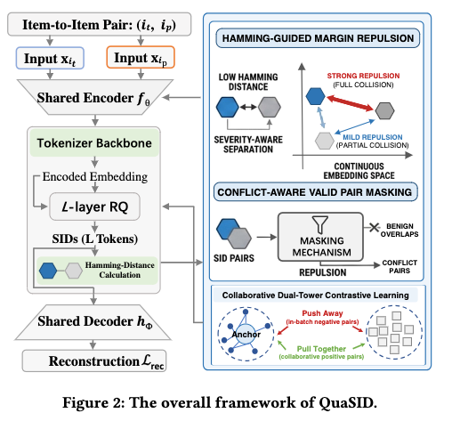

# Kuaishou: a new SID method, GMV +2%

> [中文版](kuaishou-quasid.md)

### Paper: Stop Treating Collisions Equally: Qualification-Aware Semantic ID Learning for Recommendation at Industrial Scale
### Link: https://arxiv.org/pdf/2603.00632
### Company: Kuaishou
### Idea: contrastive learning
### Area: SID

## Overview:
It designs a method that reduces SID collisions and so yields better SIDs.
On top of the existing RQ-VAE learning tasks, it adds two auxiliary tasks: (1) penalizing collisions in the generated SIDs, and (2) contrastive learning to improve the multimodal encoder. Both align the continuous embedding space before quantization. In detail:

### (1) SID collision penalty task
(trigger, target) pairs are "co-occurrence positive pairs" sampled from real user behavior logs. Within a batch of size B, the SIDs of every pair of items are compared to see whether they collide, and collisions are penalized to improve SID modeling. This actively injects collaborative signal, so the SIDs learn behavioral similarity.

#### Building the penalty mask matrix
Within a batch, for any pair of items: if they are a co-occurrence positive pair or the same item, having the same SID is normal and needs no penalty; otherwise it should be penalized.
A batch has 2B items in total, so a mask matrix of shape (2B, 2B) can be formed, with 1 for pairs to penalize and 0 otherwise.

#### Building the Hamming distance matrix
Within a batch, a Hamming distance matrix of shape (2B, 2B) is built, where each entry compares item i's SID with item j's SID. An SID of length L has L tokens; the two token sequences are compared position by position, and the number of mismatches is the entry value.

Pairs fall into these classes:
* Full collision: entry value is 0
* Partial collision: entry value is nonzero and at most the hyperparameter R
* Normal: entry value is greater than the hyperparameter R

#### Collision penalty
Full and partial collisions are penalized. Using the embeddings that the encoder produces for the (trigger-target) pair, a hinge loss is computed, with different "minimum safety margins to push apart" for full and partial collisions: larger for the former, smaller for the latter. So different collisions get different penalties, which is the "conflict-aware" part of the title.

### (2) Contrastive learning task
The SID collision penalty maps multimodal embeddings to suitable discrete IDs and reduces collisions; if at the same time the encoder itself models better, and therefore the multimodal embeddings are better, all the better.
Concretely, with the constructed collaborative positive pairs (trigger-target), contrastive learning with an InfoNCE loss is applied to their encoder embeddings, "pulling together" items that users co-engage with in continuous space, so that the SIDs carry both multimodal and collaborative behavioral semantics.

**A/B**: Kuaishou e-commerce, recommendation scenario GMV +2.38%, cold-start orders up to +6.42%.

## Takeaways:
* Aligning with collaborative information is already standard practice. Earlier work and this paper both show it.
* The collision penalty is also a form of contrastive learning. Contrastive learning is good at telling things apart, which yields high-quality SIDs.

## Caveats
* The penalty mask matrix and the Hamming distance matrix are a bit theoretical, especially the former (the latter is slightly better), and they hurt readability.

## Credibility: production

## Recommendation: practically useful

