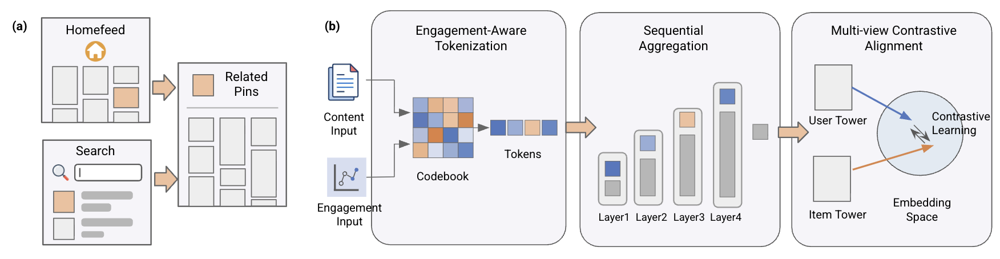

# Pinterest：SID接入双塔召回，冷启转存+3.67%

关注我，每天为你精挑细选最优质、最新鲜的推荐算法paper，陪你一起保持进步、不断精进！

### 论文：Pin-SCALE: Semantic Cascading and Alignment Learning for Engagement-Aware IDs in Cold-Start Recommendations
### 网址：https://doi.org/10.1145/3805712.3808507
### 公司：Pinterest（SIGIR '26）
### 思想：GNN 表征能力强、可学的层级融合、对比学习补监督
### 方向：SID、双塔召回

## 解读：

众所周知，SID 能解决冷启，本文将item的SID接入双塔召回模型，试图提升冷启的推荐效果。在 Closeup、Home Feed、Search 多个场景全量上线，日均服务数十亿请求。

方法按流水线分三块：SID 怎么生成出来、怎么接进双塔、双塔怎么训。

左边是 Pinterest 的两个入口（首页流、搜索）通向 Related Pins；右边三个框正好对应下面三节。

## 1 生成 SID：把协同信号放进量化器的输入

主流的做法，SID 只从内容生成。本文的做法是**换掉送进量化器的那个表征**，用本身就编码了协同信号的，就是用Pinterest 2025年的模型OmniSAGE获得的item embedding，它是用户-item 交互图聚合邻居的 GNN 表征。

相比内部大模型的文本表征、图文对齐的多模态表征（PinCLIP），**OmniSAGE 大幅胜出**，冷启曝光 +1.72%。论文还给了一个可以离线预判的指标：**第一层码本的熵越大，线上表现越好**。OmniSAGE 的熵 10.93（上限 11）、码本利用率 100%；PinCLIP 图文融合版熵 7.42、利用率只有 9.7%。不用上线就能先筛掉一批方案。

注意：注入协同信号会带来 **SID drift**，需要更频繁地重训量化器。

## 2 接入双塔：层级级联池化

拿到一串 SID token，要先聚合成一个 item 向量才能进双塔。本文的做法是**从粗到细逐级融合的一个融合网络**：$h_\ell = \mathrm{MLP}_\ell([h_{\ell-1}; e_{\ell+1}])$，其中 $h_0 = [e_{raw}; e_1]$——拿原始内容 embedding 和最粗的 token 起手，一层层把更细的 token 叠进来。

本文涉及四个场景，SID的接入位置：
* Closeup（详情页i2i），因为两边都是 item，左右塔都可以用都有 SID；
* Search： 是query2item，Item主要在右塔，只用在右塔；
* Home： User2item，用在右塔（item 侧）；
* 购物召回：User + Query2item，用在右塔。

## 3 训练双塔：多视角对比学习

双塔常常用对比学习提高模型表征能力，本文也不例外。两个视角：

**跨塔对齐（Q2C）**：双塔常有「表示发散」的毛病——语义相近的东西被映射到两个不相干的空间。做法是把**同一个 item 分别过 query 塔和 candidate 塔，当作正样本对**。妙处在于：一个零互动的新 pin，只要它在某个 batch 里当过候选、在另一个 batch 里当过 query，两边的表示就被显式拉到一起，**完全不需要它有任何互动记录**。

注意：Q2C 主要是在 Closeup （pin的详情页推荐场景）这种 i2i 同构场景下发挥作用，其他异构场景（Search、Home Feed、购物）不做。

**共现对齐（Q2Q / C2C）**：同一 batch 里共享候选的两个 query 构成正样本对。冷启 item 自己没互动，但它和热门 item 的共现关系是现成的监督信号。

4个场景的模型是独立训练的。在每个模型训练的时候，只要在一个batch里，共享左边query（此处的意思，可以是搜索词，可以是item）的两个右边candidate，构成正样本；同时，共享右边candidate的两个左边query（search query or item），构成正样本。

## 三个设计各补上了什么

上面三步中，作用和价值是：
* SID生成时的**行为感知分词补的是信息洞。** 纯内容生成的 SID，内容像不等于用户反应像——冷启时这个问题最突出，新 item 可能拿到一个语义上说得通、但完全不预示互动的 ID。
* SID接入模型时的**级联池化补的是结构洞。** RQ-VAE 的残差结构决定了 token 有序——第 1 层解释最多方差，越往后越精细。而此前的做法把 token 当无序集合（拼接、mean pooling、n-gram 哈希、SentencePiece），层级信息直接丢了。Attention pooling 也只能部分捕捉：它独立处理各 token，可能在首尾之间建立强连接，却漏掉定义 SID 的那条依赖链。
* 模型训练时的**对比学习补的是目标洞。** SID embedding 喂进深层网络会梯度消失，长尾 SID 更惨：出现少、更新少，梯度本来就弱，表示一直是噪声。对比学习给的是不依赖标签的密集信号，正好填这段真空。

## A/B效果

在 Closeup 上通过跨塔对齐使站点级新鲜 Repin 提升 3.67%，并在 Home Feed 带来 DAU +0.05%，同时在 Search 和购物场景分别提升新鲜长点击与转存等指标。

## 心得：
* **「码本利用率和熵能预判线上效果」是全文最省钱的发现。** 不用上线就能先筛方案，这类离线代理指标在工业界的价值被严重低估——大部分团队还是靠直觉选完直接上。
* 把协同信号注入 SID 有两条路：**改送进量化器的那个表征**（本文），或者**让推荐损失的梯度回传进码本**（端到端联合训练）。前者轻得多，也不破坏码本的冻结契约，代价只是要更频繁重训。
* 本文SID的层次深度大，少见。在 生成式检索（TIGER 一类）里，SID的层次深度8 确实偏深，多数工作用 3–4 层。在 大规模判别式检索/排序 里，8层虽然有，但是也算是少见。

## 愚见

## 可信度：生产

## 推荐等级：有实践价值

**请帮忙点赞、转发，谢谢。欢迎干货投稿 \ 论文宣传\ 合作交流**

### 【铁粉】请入微信群，群内我会给出更深入的解读，还可以共同讨论技术方案、发招聘广告、内推和交友等。
* 铁粉标准：关注公众号一个月以上，且在公众号上累计15次互动（评论、爱心、转发）、或投稿1次，只欢迎技术同学。
* 入群方法：请您加个人微信lmxhappy，我拉您入群，请备注【公司】（只我个人看，不公开）。

## 推荐您继续阅读：
* [Tokens are All You Need — 从SID重建内容embedding (YouTube)](youtube-dual-sid.md)
* [QuaSID — SID 量化新方法，GMV+2% (快手)](kuaishou-quasid.md)
