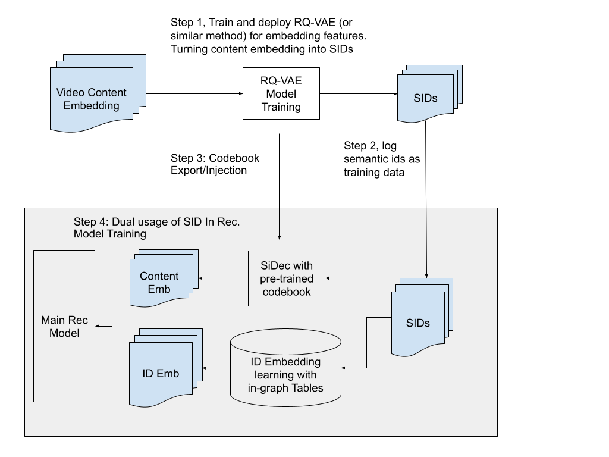

# YouTube: reconstructing content embeddings from SIDs makes long sequences finally affordable

> [中文版](youtube-dual-sid.md)

### Paper: Tokens are All You Need: Dual-purpose Semantic IDs for Achieving LLM-Level I/O Efficiency in Recommendation Systems
### Link: https://arxiv.org/abs/2607.24865
### Company: Google
### Idea: lossy compression, trading compute for bandwidth
### Area: SID

## Overview:

This paper got a Best Paper nomination in the RecSys 2026 industry track. The approach: the logs don't record an item's content embedding, only its SID; at training and inference time a small model turns the SID back into a content embedding, used for both sequence items and the target item, to improve modeling.

Why take the detour: with long sequences, moving a dense content vector for every position is too expensive, and in practice content features had long been cut; meanwhile the SID, as an identity feature, is already sitting in the logs. So what this paper does is let **the content signal hitch a ride that has already been paid for**.

Two steps below: first how SIDs are generated, then how the same token sequence is used as both identity and content; finally a closer look at the implementation details of the collaborative path.

## 1 Only tokens are stored in the logs

First, **RQ-VAE (residual quantization)** turns the content vector into a sequence of integers. The procedure: prepare a "codebook", which you can think of as a book of pre-clustered standard vectors, each with a number; find the entry closest to the target vector and record its number, then take the residual "original vector minus that entry" and find a second entry, and repeat for several rounds. The resulting numbers are the video's Semantic ID.

**Where's the saving?** A 256-dim content vector is 256×32 = 8192 bits in FP32. After quantization, assuming 8 rounds and a codebook of 4096 entries (12 bits per number), it takes only 8×12 = 96 bits in total, **less than one percent of the original**. The paper gives a compression range of 50 to 100x. (The exact number of rounds and codebook size are not disclosed in the paper; this is an illustration back-computed from the compression ratio.)

The logs record this number sequence directly, not the raw vector (Step 2 in the figure), while the codebook is exported offline and injected into the recommendation model (Step 3), not carried along with the samples. This is also why the whole thing works: **codebook size depends only on "how many standard vectors there are", not on "how many videos there are"**, so it is small enough to fit inside the model graph.

## 2 Dual purpose: the same tokens do two jobs

"Dual purpose" does not mean two models; it means **the same token sequence is reused twice** (Step 4 in the figure). The two paths have independent parameters and independent training objectives, and are concatenated inside the model at the end.

**One path as collaborative identity.** Each token is treated as a categorical feature, looked up in a learnable embedding table, and trained along with the main model's recommendation loss. This path learns "who likes this video": a pure collaborative signal, unrelated to content semantics.

**The other path reconstructs content.** The same tokens look up the injected codebook and then go through a lightweight decoder called **SiDec** (i.e. the decoder in RQ-VAE, usually implemented as an MLP or a shallow Transformer), computing an approximation of the content vector on the fly. This path is trained with MSE to fit the original content embedding and learns "what this video is about in content". The paper tried two versions: v0 decodes to 64 dims, v1 to 256 dims; v1 is better.

**The division of labor is clear: the former handles memorization, the latter generalization.** The collaborative path is accurate for high-frequency items, but a new video has no views and its row in the table is still at initialization; the content path doesn't depend on any interaction history, so a video has a signal as soon as it's uploaded. **Cold start and the long tail rely on it as a fallback.**

Throughout, the storage side holds only integer tokens; dense vectors are reconstructed in real time on the accelerator. In essence it trades compute for bandwidth: running an MLP is cheap, moving 200KB is expensive.

### Detail: how to organize tokens for the collaborative path

The same tokens, organized differently, give different trade-offs between memorization and generalization. The paper lists four options: **Unigram** looks up each token independently and then aggregates, the most memory-efficient but it loses the hierarchy;
**Overlapping Bigram** uses a sliding window over pairs of adjacent tokens for lookup, which captures semantic neighborhoods;
**Nested N-gram** looks up by prefix level by level: one table for the 1st token, one for the first 2, one for the first 3, so semantically similar items share higher-level embeddings;
**SentencePiece** doesn't specify anything by hand and learns how to segment and combine from the data distribution.

The paper gives no single global winner, but states clearly that **nested N-gram and SPM are better suited to cold start**, the reason being prefix sharing: long-tail items can borrow parameters from high-frequency items.

## A/B results
Run on both YouTube's ranking and retrieval models. Ranking: site-wide satisfied engagement +0.09%, watch page +0.80%, home page +0.08% to 0.22%. Retrieval: site-wide +0.06%, home page +0.13%. The paper stresses that the gains are **disproportionately concentrated on new accounts and long-tail content**.

## Supplement: a timeline of content features in models

This paper needs to be seen along an evolution line; otherwise it looks like "it's just storing some tokens".

**Stage 0: content embeddings used directly.** Text, video and image representations were concatenated into the model as side features. Sequences weren't long then, the cost of moving dense vectors was affordable, and both interaction signal and content semantics could be learned.

**Stage 1: sequences get long, content embeddings become unaffordable.** Long user histories were shown to clearly help ranking quality, and sequences grew from dozens to hundreds or thousands. Every position needs a dense vector moved, so I/O grows linearly with length. The paper gives concrete numbers: with history length 200 and dimension 256, this part alone is 51,200 floats per training sample, **200KB** in FP32; multiply by billions of samples and you hit the bandwidth ceiling. So in practice content features were downgraded or even cut, leaving only cheap ID-type features in the sequence.

**Stage 2: SIDs arrive and solve identity generalization.** RQ-VAE quantizes content embeddings into hierarchical semantic IDs, first used for generative retrieval (Rajput 2023), later brought into YouTube ranking (Singh 2024): atomic IDs memorize well but generalize poorly, raw content representations generalize well but memorize weakly, and the hierarchical sub-block structure of SIDs gets both. SIDs thus became the standard identity feature for sequence items in production. **But they only carry "identity"**: the model knows which items this one resembles, but can't get at the content semantics that were quantized away.

**Stage 3: SiDec lets content features ride on SIDs.** The core insight is simple: SIDs are quantized from content embeddings to begin with, so they **are** a compressed code of content semantics. Since production already pays the I/O for SIDs, there's no need to pay a second time for content embeddings: a codebook lookup plus a lightweight decoder computes the content vector on the accelerator on the fly.

In one line: **the content embedding never left the model; what changed is the channel it enters through**, from moving dense vectors every time, to moving only integer tokens, to moving integer tokens and computing the content signal on the spot.

## Takeaways:
* It's mainly about cutting cost, and improving quality comes second. Also using SIDs as features, previous work compared "how much AUC goes up when this feature is added"; this paper compares "how cheap this feature is". As long as quality doesn't drop, a large cost cut is enough to ship.
* The gains concentrate on the long tail and new accounts, and both paths contribute: the content path doesn't depend on interaction history, so new videos naturally have a signal; the collaborative path uses nested N-gram prefix sharing, so low-frequency items can borrow parameters from high-frequency items. Both are more practical than "train low-frequency IDs for a few more epochs": the sample count is what it is, and more training won't get you there.
* The collaborative way of using SIDs given in this paper is worth adopting and trying in industry.

## Caveats

## Credibility: production (YouTube ranking and retrieval, deployed with online A/B)

## Recommendation: practically useful
